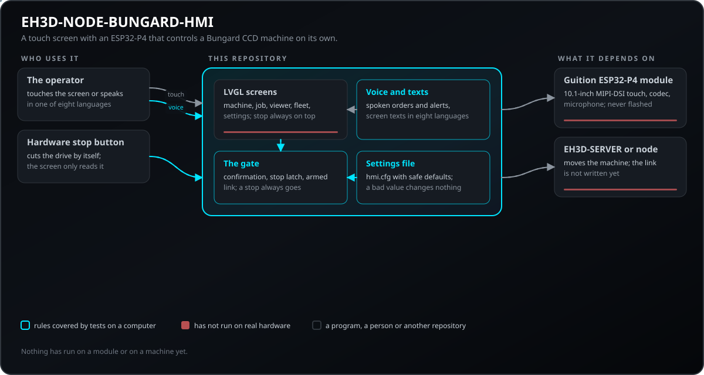
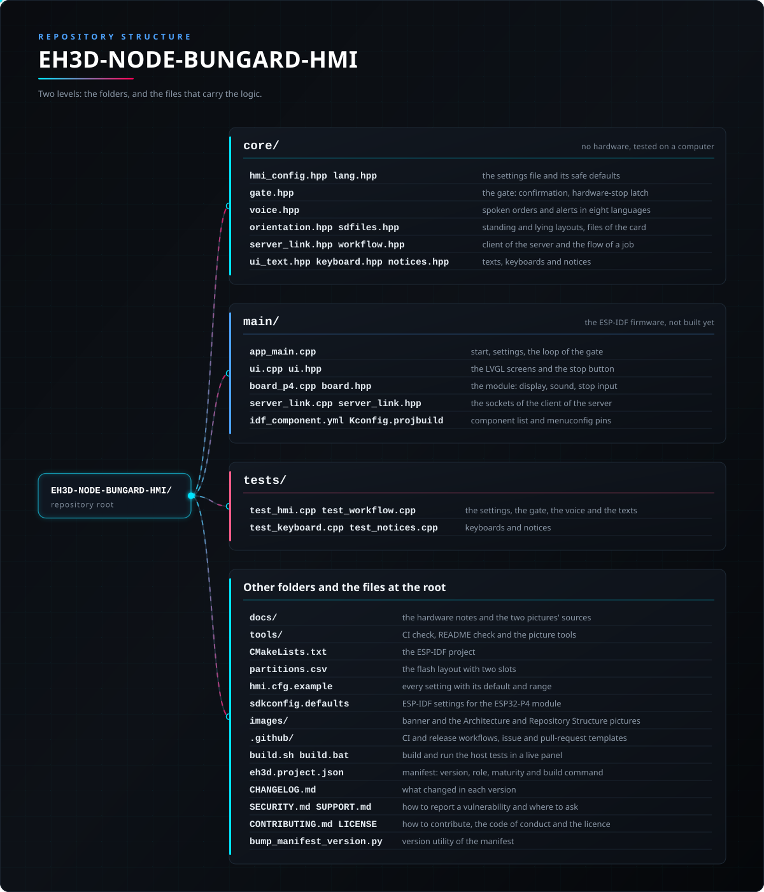

<p align="center">
  
</p>

# 🖥️ EH3D-NODE-BUNGARD-HMI

<p align="center"><a href="README.md">🇺🇸 English</a> | <a href="README_spa.md">🇪🇸 Español</a> | 🇫🇷 <b>Français</b> | <a href="README_ita.md">🇮🇹 Italiano</a> | <a href="README_deu.md">🇩🇪 Deutsch</a> | <a href="README_zho.md">🇨🇳 中文</a> | <a href="README_jpn.md">🇯🇵 日本語</a> | <a href="README_por.md">🇵🇹 Português</a></p>

### Un écran tactile de 10,1 pouces avec un ESP32-P4 qui pilote seul une machine Bungard CCD : les écrans et le déroulement du programme de bureau, en huit langues, des alertes et des ordres vocaux, et un arrêt matériel qui ne passe pas par l'écran.

<p align="center">
  
  
  
  
  
</p>

---

**Vérification d'honnêteté - ce qui tourne aujourd'hui :** les règles de l'écran sont écrites en C++17 et testées sur un ordinateur : le fichier de réglages avec ses valeurs sûres par défaut, la porte que tout déplacement et tout ordre de broche doit franchir (une confirmation à l'écran, le verrou de l'arrêt matériel, la liaison armée), les ordres et alertes vocaux en huit langues et les textes des écrans. Le firmware ESP-IDF avec les écrans LVGL est écrit pour le module Guition JC8012P4A1C mais **n'a pas été compilé, flashé ni exécuté sur un module**, il n'y a pas encore de liaison avec le serveur ou la machine et rien n'a été branché sur une machine.

---

> **État de sécurité (safety) et de sécurité informatique :** ceci n'est pas un système de sécurité (safety). L'arrêt qui protège les personnes et la machine est un bouton matériel qui coupe l'entraînement de lui-même, câblé à part de cet écran ; l'écran ne fait que le lire, l'afficher et refuser de déplacer quoi que ce soit tant qu'il est enfoncé ou non acquitté. Un déplacement ou un ordre de broche demande une confirmation à l'écran, un ordre vocal toujours, et les ordres vocaux sont désactivés jusqu'à ce que l'opérateur les active. N'utilisez pas cet écran pour conduire une machine avant que toute la chaîne ait été essayée sur une vraie. Le projet est indépendant : il n'est ni fabriqué, ni approuvé, ni soutenu par Bungard Elektronik ou Guition, et les noms de produits n'apparaissent que pour dire avec quelles machines et quels modules il est prévu de fonctionner.

## 📋 En un coup d'œil

| | |
|---|---|
| Version | `0.0.1` |
| Maturité | Échafaudage |
| Tests | 1 programme de test sur ordinateur (598 vérifications comptées) |
| Pile technique | C++17, ESP-IDF 5.5, LVGL 9, ESP32-P4 |
| Sur du matériel réel | Non : le firmware n'a été ni compilé ni flashé et rien n'a été branché sur une machine |

**Aller à  :** [Présentation](#-présentation) · [Architecture](#-architecture) · [Démarrage rapide](#-démarrage-rapide) · [Tests](#-tests) · [Structure](#-structure-du-dépôt) · [Liés](#-projets-liés)

## 🚦 État du projet

Chaque ligne est une partie de ce dépôt et le feu dit où elle en est aujourd'hui. Elle est écrite d'après ce que le dépôt peut montrer (tests, compilations, exécutions), pas d'après ce qui est prévu.

🟢 Fait et vérifié · 🟡 Fonctionne, avec des limites connues · 🟠 À moitié fait ou pas encore vérifié · 🔴 Pas fait ou ne fonctionne pas

| Domaine | État | Ce que cela veut dire ici |
|---|---|---|
| Logiciel | 🟠 | Le projet ESP-IDF (ESP32-P4, LVGL 9, le fichier de réglages dans sa propre partition) est écrit ; il n'a été ni compilé ni flashé. |
| Tests | 🟢 | 1 programme de test sur ordinateur réussit (`ctest`) : 598 vérifications du fichier de réglages, de la porte, des ordres et alertes vocaux et des textes des écrans en huit langues. |
| Règles de sécurité | 🟡 | Tout déplacement et tout ordre de broche passent par la porte : confirmation à l'écran, verrou de l'arrêt matériel que seul un acquittement à l'écran lève une fois le bouton relâché, aucun déplacement si la liaison n'est pas armée. Couvert par des tests ; jamais essayé avec un vrai bouton d'arrêt. |
| Voix | 🟡 | Les ordres et alertes vocaux sont reconnus et formulés en huit langues et testés comme du texte ; aucun micro ni haut-parleur n'a été utilisé. |
| Écrans | 🟠 | L'écran de la machine (jog, origine, broche, démarrage, arrêt, confirmation, bandeau d'arrêt matériel) est écrit ; les onglets vue, travail, machines et stations et réglages sont encore des pages vides. |
| Matériel réel | 🔴 | Aucun module n'a exécuté ce firmware, la liaison avec le serveur n'existe pas encore et rien n'a été branché sur une machine. |
| Documentation | 🟢 | README en huit langues, la référence des réglages et les notes matérielles. |

## 🎯 Présentation

* La **porte** : tout déplacement et tout ordre de broche, par toucher ou par la voix, passe par un seul endroit qui décide de l'exécuter, de demander une confirmation ou de le refuser avec un motif ; un arrêt passe toujours.
* Le **fichier de réglages** `hmi.cfg` : chaque valeur ajustée (langue, luminosité, le serveur, les interrupteurs de sécurité, la voix) est une ligne d'un fichier dans sa propre partition, jamais un nombre dans le code ; une valeur hors plage est signalée et la valeur sûre par défaut reste.
* La **voix** : alertes parlées (travail terminé, changement d'outil, erreur, liaison perdue, arrêt matériel) et une courte liste fixe d'ordres vocaux en huit langues ; les ordres qui ne font qu'arrêter se comprennent dans une phrase, ceux qui déplacent ou font tourner doivent être dits en entier et demandent toujours une confirmation.
* Les **écrans** : la machine (jog, origine, broche, démarrage, arrêt), le travail, la vue, les machines et stations du serveur et les réglages, dans l'ordre et avec les noms du programme de bureau ; le bouton d'arrêt est toujours en haut.
* Le **module** : le Guition JC8012P4A1C (ESP32-P4 avec 32 Mo de RAM externe, écran tactile MIPI-DSI de 10,1 pouces en 800x1280, un ESP32-C6 pour le Wi-Fi, le codec ES8311 avec amplificateur de haut-parleur et l'entrée micro ES7210). La dalle de l'unité est la nouvelle.

## 🧩 Rôle dans EH3D

EH3D-NODE-BUNGARD-HMI est l'écran propre de l'opérateur d'une machine Bungard CCD : il remplace le PC à côté de la machine. Il est prévu pour piloter la machine via EH3D-SERVER ou EH3D-NODE-BUNGARD (le nœud sur le port série de la machine), comme le font EH3D-DRILLPRO et EH3D-ROUTEPRO. Cette liaison n'est pas encore écrite.

## 🏛️ Architecture

<p align="center">
  
</p>

Comment s'assemblent les parties de ce dépôt : qui lui parle, ce qu'il contient et de quoi il dépend. Le dessin est tiré de `docs/architecture.json` et vérifié par rapport au code.

## ✨ Fonctionnalités

* **Un arrêt qu'on ne peut pas oublier :** le bouton d'arrêt est toujours en haut et fonctionne toujours ; l'arrêt matériel se verrouille et seul un acquittement à l'écran, bouton relâché, le lève.
* **Confirmation avant le mouvement :** un déplacement ou un ordre de broche montre ce qu'il va faire et attend un toucher, avec une limite de temps ; une nouvelle demande ou une liaison perdue l'abandonne.
* **Huit langues, aussi à la voix :** anglais, espagnol, italien, allemand, français, portugais européen, chinois et japonais dans les écrans, les alertes parlées et les ordres vocaux.
* **Sûr par défaut :** chaque interrupteur de sécurité a son réglage et démarre dans sa position prudente : ordres vocaux désactivés, confirmation vocale désactivée, confirmation activée, arrêt matériel exigé.

## 🔒 Sécurité et protection

| Menace | Défense |
|---|---|
| Un toucher ou un ordre vocal qui déplace la machine par accident | un déplacement demande une confirmation à l'écran avec une limite de temps ; un ordre vocal en demande toujours une ; un oui parlé ne confirme que si le réglage `voice_confirm` est activé (désactivé par défaut) |
| L'écran déplace pendant que l'arrêt matériel est enfoncé | l'arrêt matériel est un verrou : enfoncé, ou relâché mais non acquitté à l'écran, tout déplacement et tout ordre de broche sont refusés et ce qui attendait est abandonné ; un arrêt enfoncé pendant qu'une confirmation attend l'annule |
| Une machine pas prête | rien ne bouge si la liaison n'est pas armée, si l'entrée d'arrêt matériel n'est pas câblée (`hw_stop_required`, activé par défaut) ou si la limite de broche vaut 0 |
| Un mot parlé pris pour un ordre | les ordres viennent d'une courte liste fixe par langue, jamais d'un texte libre ; un mot qui ne fait que contenir un ordre (`stopwatch`) n'est pas un ordre ; les ordres vocaux sont désactivés jusqu'à ce que l'opérateur les active |
| Une faute de frappe dans les réglages | une valeur hors plage ou une clé inconnue est signalée et la valeur sûre par défaut reste ; aucun interrupteur ne s'ouvre par erreur |
| Un secret dans le firmware ou dans le dépôt | rien de secret n'est compilé ; le jeton est un réglage dans sa partition et n'est jamais affiché ni journalisé |

**Ce qui n'est pas défendu :** l'écran n'est pas un dispositif de sécurité et ne peut pas couper l'entraînement de la machine ; l'arrêt matériel doit le faire seul. Il n'y a pas encore de liaison avec le serveur, donc l'écran ne peut aujourd'hui déplacer aucune machine. La reconnaissance vocale est testée comme du texte ; le vrai chemin du micro (annulation d'écho, bruit, accents) n'a pas été essayé. Qui a le module en main peut changer le fichier de réglages.

## 🔌 Interfaces

| Interface | Ce que c'est | Où |
|---|---|---|
| Fichier de réglages | `hmi.cfg` dans la partition `config` : lignes `clé = valeur` ; voir `hmi.cfg.example` et le tableau ci-dessus | `core/hmi_config.hpp` |
| Entrée d'arrêt matériel | un GPIO (`HMI_HW_STOP_GPIO` dans menuconfig, actif bas par défaut, avec pull-up pour qu'un fil ouvert compte comme enfoncé) | `main/board_p4.cpp` |
| Écran tactile | MIPI-DSI 800x1280 via LVGL 9 | `main/ui.cpp` |
| Son | codec ES8311 avec amplificateur de haut-parleur et entrée micro ES7210 | `main/board_p4.cpp` |

## ⚙️ Configuration

Tout ce qui est ajusté est une ligne de `hmi.cfg` (copiez `hmi.cfg.example` dans la partition `config`) ; une valeur hors plage est signalée dans le journal et la valeur par défaut reste. Les valeurs ci-dessous sont celles par défaut ; chaque défaut de sécurité est le défaut prudent.

| Réglage | Défaut | Plage | Ce que ça fait |
|---|---|---|---|
| `language` | `en` | `en es it de fr pt zh ja` | la langue des écrans et de la voix |
| `confirm_moves` | on | on / off | demande une confirmation pour déplacer : à désactiver seulement sur le banc |
| `confirm_timeout_ms` | 8000 | 1000 - 60000 | combien de temps une confirmation attend |
| `jog_max_mm` | 20 | 1 - 200 | le plus long jog que l'écran envoie |
| `spindle_max_rpm` | 24000 | 0 - 65535 | la vitesse de broche maximale demandée (0 : ne démarre jamais la broche) |
| `hw_stop_required` | on | on / off | ne pilote la machine que si l'entrée d'arrêt matériel est câblée et relâchée |
| `voice_orders` | off | on / off | accepte les ordres vocaux |
| `voice_confirm` | off | on / off | accepte un oui parlé comme confirmation d'un déplacement |
| `token` | none | 8 - 64 characters | le jeton d'accès au serveur ; en écriture seule, jamais affiché ni journalisé |

## 🚀 Démarrage rapide

Il faut un compilateur C++17 et CMake pour les tests sur ordinateur, et ESP-IDF 5.5.5 pour le firmware (la cible ESP32-P4 du module).

```bash
build.bat            # the host tests (Windows)  -  ./build.sh on Linux
python -I tools/ci_validate.py
```

Le firmware n'a pas encore été compilé : le moment venu, `idf.py set-target esp32p4 && idf.py build` produit l'image et une partition nommée `config` contient `hmi.cfg`.

## 🧪 Tests

Les tests sur ordinateur (`build.bat` ou `./build.sh`, puis `ctest`) sont un programme, `test_hmi`, et tout passe : 598 vérifications du fichier de réglages (défauts, plages, fautes, fins de ligne), de la porte (l'arrêt passe toujours, verrou de l'arrêt matériel, confirmation, délai et débordement de l'horloge, règles vocales, interrupteurs), des ordres et alertes vocaux en huit langues et des textes des écrans.

## 🏗️ Compilation et publication

La version vit dans `eh3d.project.json`, et chaque version a son entrée dans [CHANGELOG.md](CHANGELOG.md). `build.sh` / `build.bat` compilent et lancent les tests sur ordinateur et `test.sh` / `test.bat` lancent les contrôles du dépôt. Le firmware se compile en dehors des scripts de ce dépôt, dans une fenêtre visible, une compilation à la fois.

## 🩺 Dépannage

| Symptôme | Que faire |
|---|---|
| Rien ne bouge et l'écran dit que l'arrêt matériel est enfoncé ou non acquitté | Relâchez le bouton puis appuyez sur le bouton d'acquittement de l'écran : un arrêt relâché ne se lève pas tout seul. |
| L'écran dit que la machine n'est pas armée | Dans cette version il n'y a pas encore de liaison avec la machine ; la porte refuse tout déplacement tant qu'une liaison ne l'arme pas. |
| L'écran dit que l'entrée d'arrêt matériel n'est pas câblée | Câblez le bouton d'arrêt à la broche fixée dans menuconfig (`HMI_HW_STOP_GPIO`), ou désactivez `hw_stop_required` uniquement sur le banc. |
| Un ordre vocal ne fait rien | Les ordres vocaux sont désactivés par défaut : mettez `voice_orders = on`. Ceux qui déplacent ou font tourner demandent un toucher à l'écran sauf si `voice_confirm` est activé. |

## 📂 Structure du dépôt

<p align="center">
  
</p>

<details>
<summary>Version texte de l'arborescence</summary>

```text
EH3D-NODE-BUNGARD-HMI/
├── core/
│   ├── hmi_config.hpp lang.hpp                  le fichier de réglages et ses valeurs sûres
│   ├── gate.hpp                                 la porte : confirmation, verrou d'arrêt
│   ├── voice.hpp                                ordres et alertes vocaux en huit langues
│   └── ui_text.hpp                              les textes des écrans en huit langues
├── main/
│   ├── app_main.cpp                             démarrage, réglages, la boucle de la porte
│   ├── ui.cpp ui.hpp                            les écrans LVGL et le bouton d'arrêt
│   ├── board_p4.cpp board.hpp                   le module : écran, son, entrée d'arrêt
│   └── idf_component.yml Kconfig.projbuild      liste des composants et broches de menuconfig
├── tests/                                       tests sur ordinateur des réglages, de la porte, de la voix et des textes d'écran
├── docs/                                        les notes matérielles et les sources des deux images
├── tools/                                       contrôle CI, contrôle du README et outils des images
├── CMakeLists.txt                               le projet ESP-IDF
├── partitions.csv                               la répartition de la flash à deux emplacements
├── hmi.cfg.example                              chaque réglage avec sa valeur par défaut et sa plage
├── sdkconfig.defaults                           réglages ESP-IDF pour le module ESP32-P4
├── images/                                      bannière et images d'Architecture et de Structure du dépôt
├── .github/                                     workflows de CI et de publication, modèles d'issues et de pull requests
├── build.sh build.bat                           compile et exécute les tests sur ordinateur dans un panneau en direct
├── eh3d.project.json                            manifeste : version, rôle, maturité et commande de compilation
├── CHANGELOG.md                                 ce qui a changé dans chaque version
├── SECURITY.md SUPPORT.md                       signaler une vulnérabilité et poser des questions
├── CONTRIBUTING.md CODE_OF_CONDUCT.md LICENSE   contribuer, code de conduite et licence
└── bump_manifest_version.py                     utilitaire de version du manifeste
```

</details>

## 🗺️ Feuille de route et limites connues

**Limites connues aujourd'hui**

* Rien n'a tourné sur un module : le firmware n'a été ni compilé, ni flashé, ni essayé, et le paquet de support de carte demandé peut nécessiter des changements pour ce module.
* Il n'y a pas encore de liaison avec EH3D-SERVER ni avec le nœud de la machine, donc les écrans ne peuvent pas déplacer une machine ; les onglets vue, travail, machines et stations et réglages sont des pages vides.
* La broche de l'arrêt matériel et le contrôleur tactile ne sont pas encore fixés : il faut les vérifier sur le schéma de l'unité.
* Le reconnaisseur vocal et le haut-parleur ne sont pas encore dans le firmware ; les ordres et alertes sont testés comme du texte.
* La logique des programmes de bureau (formats, contrôleur, flotte) n'est pas réutilisée : les écrans suivent le programme de bureau, mais les règles sont réécrites en C++.

**La suite**

* Compiler le firmware et démarrer le module : écran, tactile et son.
* Écrire la liaison avec EH3D-SERVER et avec le nœud, et remplir les autres onglets des écrans.
* Ajouter le reconnaisseur vocal et le haut-parleur, et les essayer avec annulation d'écho.
* Câbler un vrai bouton d'arrêt et essayer le verrou sur une machine.

## 🌍 Langues

Le README et les textes existent en anglais, espagnol, français, italien, allemand, chinois, japonais et portugais européen.

## 🔗 Projets liés

* [EH3D-DRILLPRO](https://github.com/JuanenRac/EH3D-DRILLPRO): le programme de bureau que suivent les écrans
* [EH3D-ROUTEPRO](https://github.com/JuanenRac/EH3D-ROUTEPRO): le programme de défonçage ; partage le fichier de machine et la bibliothèque du protocole
* [EH3D-SERVER](https://github.com/JuanenRac/EH3D-SERVER): le centre de la famille : il exécute les travaux de chaque client
* [EH3D-NODE-BUNGARD](https://github.com/JuanenRac/EH3D-NODE-BUNGARD): le nœud sur le port série de l'unité de commande de la machine
* [EH3D-COMMON](https://github.com/JuanenRac/EH3D-COMMON): les parties communes de la famille (formats, contrôleur, flotte, thèmes)

## 📚 Documentation

* Les réglages : `hmi.cfg.example` liste chaque clé avec sa valeur par défaut et sa plage.
* Le matériel : les broches du module et les notes qui accompagnent la démo du fabricant, dans `docs/HARDWARE.md`.
* [Journal des modifications](CHANGELOG.md)

## 🤝 Contribuer et communauté

* Avant une pull request, lancez les tests sur ordinateur (`./build.sh` ou `build.bat`) et `python -I tools/ci_validate.py` : tout doit passer. Voir [CONTRIBUTING.md](CONTRIBUTING.md) et le [code de conduite](CODE_OF_CONDUCT.md).
* Le README existe en huit langues : une modification du texte se fait dans les huit fichiers, et les deux images sont dessinées depuis `docs/architecture.json` et `docs/structure.json` par `tools/make_architecture.py` et `tools/make_structure.py`.
* Rien de ce qui permet à l'écran de déplacer une machine ne change sans un test de la porte qui le couvre et une note de ce qui a été observé sur le matériel.
* Signalez une vulnérabilité en privé : [SECURITY.md](SECURITY.md). Questions, idées et signalements : electrohobby3d@gmail.com ([SUPPORT.md](SUPPORT.md)).

## 👤 AUTEUR

**JuanenRac (Electro Hobby 3D)** · electrohobby3d@gmail.com

## 📜 LICENCE

Logiciel : GPL-3.0-or-later. Voir [LICENSE](LICENSE). Les conceptions matérielles de la suite utilisent la CERN OHL-S.
