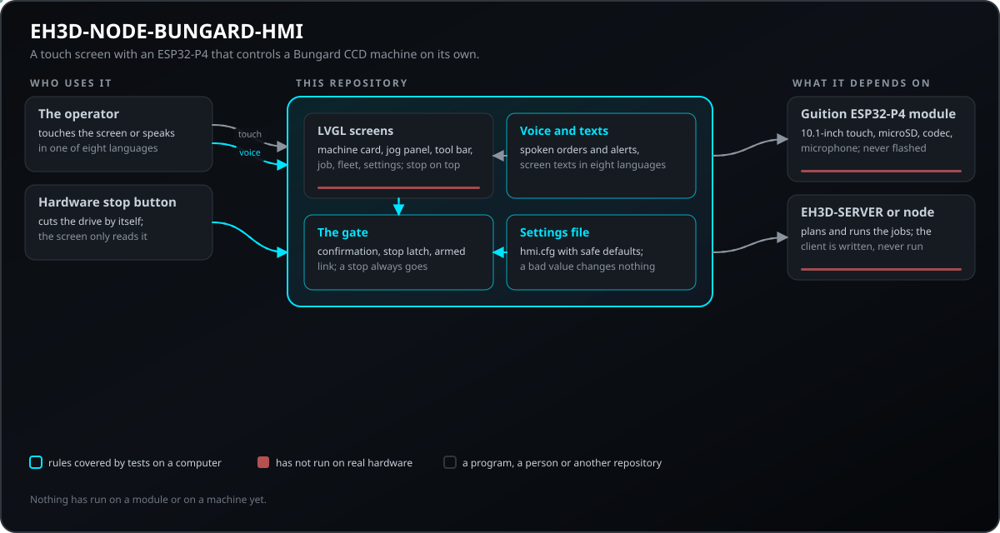
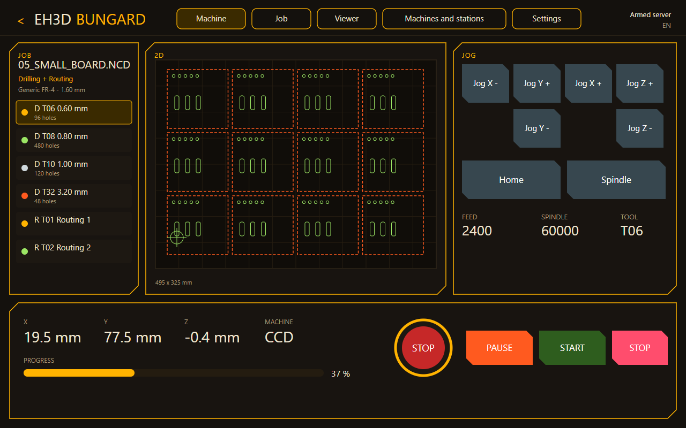
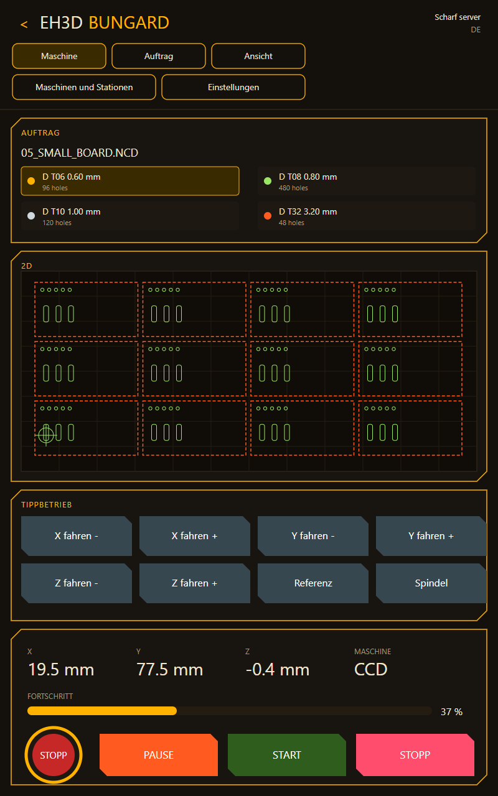
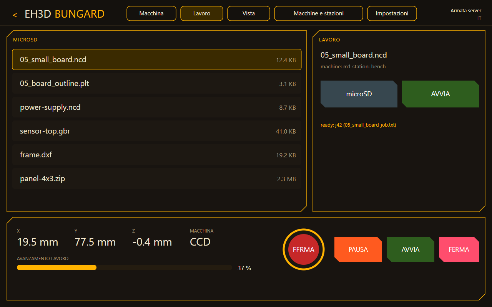
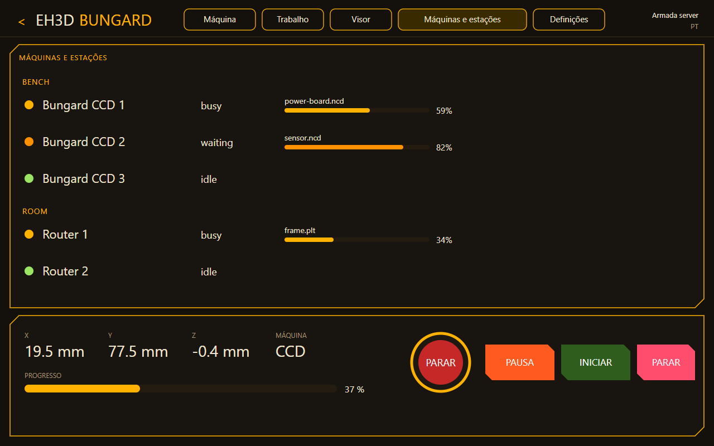
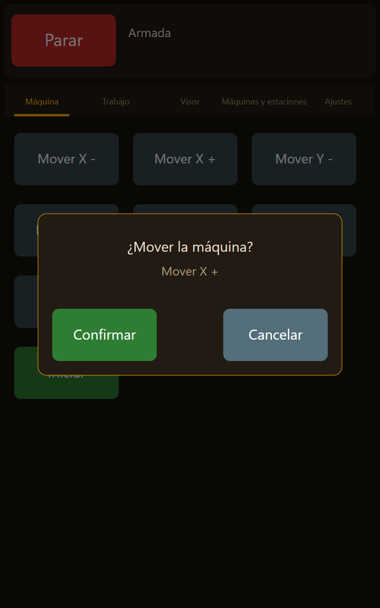
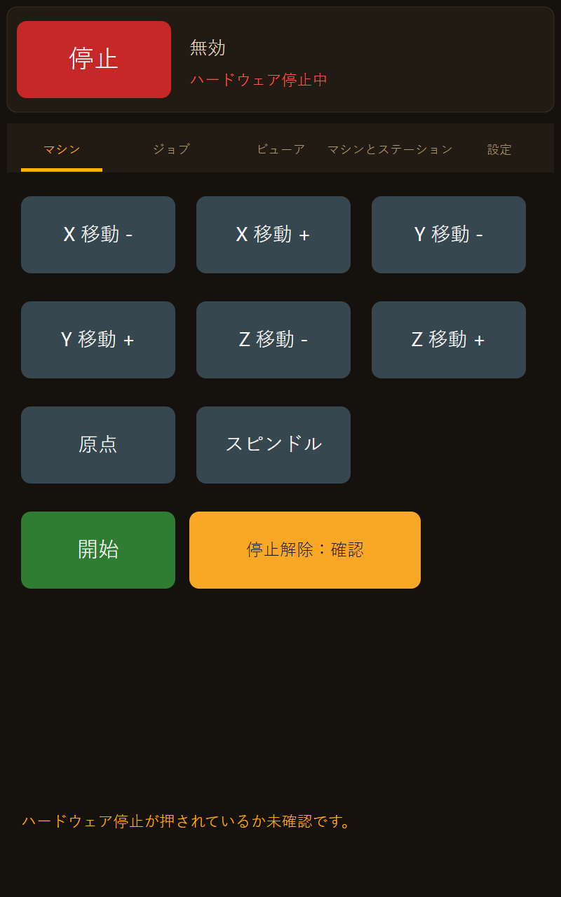
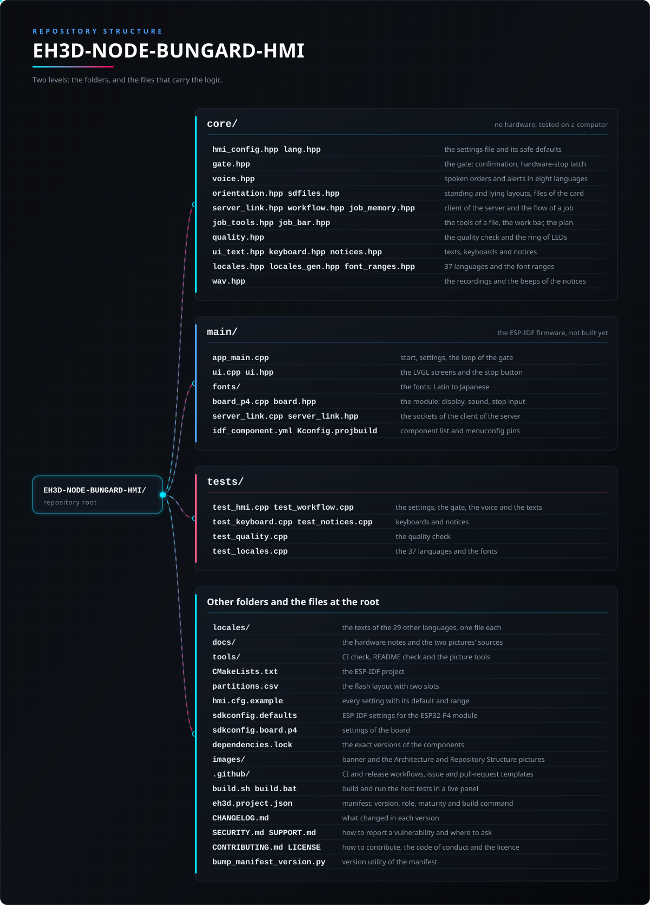

<p align="center">
  
</p>

# 🖥️ EH3D-NODE-BUNGARD-HMI

<p align="center"><a href="README.md">🇺🇸 English</a> | <a href="README_spa.md">🇪🇸 Español</a> | <a href="README_fra.md">🇫🇷 Français</a> | 🇮🇹 <b>Italiano</b> | <a href="README_deu.md">🇩🇪 Deutsch</a> | <a href="README_zho.md">🇨🇳 中文</a> | <a href="README_jpn.md">🇯🇵 日本語</a> | <a href="README_por.md">🇵🇹 Português</a></p>

### Un touch screen da 10,1 pollici con un ESP32-P4 che controlla da solo una macchina Bungard CCD: le schermate e il flusso del programma desktop, in otto lingue, avvisi e ordini vocali e un arresto hardware che non passa dallo schermo.

<p align="center">
  
  
  
  
  
</p>

---

**Verifica di onestà - cosa gira oggi:** le regole dello schermo sono scritte in C++17 e provate su un computer: il file delle impostazioni con i valori sicuri di default, il varco che ogni movimento e ogni ordine al mandrino deve superare (una conferma sullo schermo, il blocco dell'arresto hardware, il collegamento armato), gli ordini e gli avvisi vocali in otto lingue, i testi delle schermate, i layout in verticale e in orizzontale, i file della microSD e il client di EH3D-SERVER (le richieste, la lettura della flotta e il flusso di un lavoro da un file della scheda fino alla fine). Il firmware ESP-IDF con le schermate LVGL è scritto per il modulo Guition JC8012P4A1C ma **non è stato compilato, scritto né eseguito su un modulo**; non ha mai parlato con un server reale, e i movimenti della macchina stessa (spostamento, origine) aspettano il collegamento con il nodo, non ancora scritto.

---

> **Stato di sicurezza (safety) e di sicurezza informatica:** questo non è un sistema di sicurezza (safety). L'arresto che protegge le persone e la macchina è un pulsante hardware che toglie l'azionamento da solo, cablato a parte rispetto a questo schermo; lo schermo lo legge soltanto, lo mostra e si rifiuta di muovere qualsiasi cosa finché è premuto o non confermato. Un movimento o un ordine al mandrino chiede una conferma sullo schermo, un ordine vocale la chiede sempre, e gli ordini vocali sono spenti finché l'operatore non li attiva. Non usare questo schermo per far funzionare una macchina finché l'intera catena non è stata provata su una reale. Il progetto è indipendente: non è realizzato, approvato né supportato da Bungard Elektronik o Guition, e i nomi dei prodotti compaiono solo per dire con quali macchine e moduli è pensato per funzionare.

## 📋 In breve

| | |
|---|---|
| Versione | `0.0.8` |
| Maturità | Impalcatura |
| Test | 9 programmi di test sul computer (219916 controlli contati) |
| Stack tecnologico | C++17, ESP-IDF 5.5, LVGL 9, ESP32-P4 |
| Su hardware reale | No: il firmware non è stato compilato né scritto e nulla è stato collegato a una macchina |

**Vai a:** [Panoramica](#-panoramica) · [Architettura](#-architettura) · [Avvio rapido](#-avvio-rapido) · [Test](#-test) · [Struttura](#-struttura-del-repository) · [Correlati](#-progetti-correlati)

## 🚦 Stato del progetto

Ogni riga è una parte di questo repository e il semaforo dice a che punto è oggi. È scritta in base a ciò che il repository può mostrare (test, compilazioni, esecuzioni), non a ciò che è previsto.

🟢 Fatto e verificato · 🟡 Funziona, con limiti noti · 🟠 Fatto a metà o non ancora verificato · 🔴 Non fatto o non funzionante

| Area | Stato | Cosa significa qui |
|---|---|---|
| Software | 🟠 | Il progetto ESP-IDF (ESP32-P4, LVGL 9, il file delle impostazioni in una partizione propria) è scritto; non è stato compilato né scritto sul chip. |
| Test | 🟡 | 9 programmi di test sul computer passano (`ctest`): 219916 controlli sul file delle impostazioni, il varco, gli ordini e gli avvisi vocali, le tastiere, gli avvisi registrati, il client del server e i testi delle schermate in otto lingue. |
| Regole di sicurezza | 🟡 | Ogni movimento e ogni ordine al mandrino passa dal varco: conferma sullo schermo, blocco dell'arresto hardware che solo una conferma sullo schermo toglie a pulsante rilasciato, nessun movimento con il collegamento non armato. Coperto da test; mai provato con un vero pulsante di arresto. |
| Voce | 🟡 | Ordini e avvisi vocali sono riconosciuti e formulati in otto lingue e provati come testo; nessun microfono o altoparlante è stato usato. |
| Schermate | 🟠 | Le schermate macchina, lavoro (microSD), macchine e stazioni e impostazioni sono scritte, in orizzontale e in verticale, con l'aspetto del programma desktop; la scheda della vista è ancora una scheda vuota. Esiste solo un disegno del layout, non una cattura di un modulo. |
| Hardware reale | 🔴 | Nessun modulo ha eseguito questo firmware, il collegamento con il server non esiste ancora e nulla è stato collegato a una macchina. |
| Documentazione | 🟡 | README in otto lingue, il riferimento delle impostazioni e le note hardware. |
| Server e scheda | 🟡 | I file della microSD (elenco, nomi sicuri, tipi), le richieste a EH3D-SERVER, la lettura della flotta e il flusso di un lavoro (inviarlo pronto, avviarlo dal varco, seguirlo, rispondere al cambio utensile) sono provati su un computer con risposte del server scritte a mano; i socket e il driver della scheda non hanno mai girato su un modulo. |
| In comune con il programma desktop | 🟠 | La scheda del lavoro in corso, la fase tra la foratura e la fresatura, il pannello per muovere la macchina a mano e la barra del cambio utensili con i suoi posti sono scritti e provati su computer (`docs/PARITY_BUNGARD_GUI.md` dice che cosa è fatto e che cosa manca); nulla è mai girato su un modulo e i movimenti del pannello aspettano il collegamento al nodo. |

## 🎯 Panoramica

* Il **varco**: ogni movimento e ogni ordine al mandrino, da un tocco o dalla voce, passa da un unico punto che decide se eseguirlo, chiedere una conferma o rifiutarlo con un motivo; un arresto passa sempre.
* Il **file delle impostazioni** `hmi.cfg`: ogni valore regolato (lingua, luminosità, il server, gli interruttori di sicurezza, la voce) è una riga di un file in una partizione propria, mai un numero nel codice; un valore fuori intervallo viene segnalato e resta il valore sicuro di default.
* La **voce**: avvisi parlati (lavoro finito, cambio utensile, errore, collegamento perso, arresto hardware) e un breve elenco fisso di ordini vocali in otto lingue; gli ordini che fermano soltanto si capiscono dentro una frase, quelli che muovono o girano vanno detti per intero e chiedono sempre una conferma.
* Le **schermate**: la macchina (spostamento, origine, mandrino, avvio, arresto), il lavoro, la vista, le macchine e stazioni del server e le impostazioni, nell'ordine e con i nomi del programma desktop; il pulsante di arresto è sempre in alto.
* La **scheda rispetto al tavolo** e la **fine di un lavoro**: scegliendo sulla scheda un file di foratura o di percorso, la dimensione del suo riquadro viene confrontata con il tavolo della macchina (la corsa che indica il server meno lo scostamento, oppure `table_width_mm` e `table_depth_mm` di `hmi.cfg`); una scheda che non entra né distesa né ruotata viene segnalata nella pagina del lavoro con la sua dimensione e di quanto sporge, e il lavoro resta consentito (il server rifiuta ciò che cade fuori dal tavolo). Un lavoro annullato o fallito è mostrato come tale con il motivo del server, non è mai scambiato per concluso (nessun avviso di fine) e resta per riprendere dai fori già fatti; ciò che il server annota di un lavoro che chiede più di quanto dia il mandrino viene mostrato alla creazione.
* Il **modulo**: il Guition JC8012P4A1C (ESP32-P4 con 32 MB di RAM esterna, display touch MIPI-DSI da 10,1 pollici 800x1280, un ESP32-C6 per il Wi-Fi, il codec ES8311 con amplificatore per altoparlante e l'ingresso microfono ES7210). Il pannello dell'unità è quello nuovo.
* **In piedi o sdraiato:** l'impostazione `orientation` (`auto`, `landscape`, `portrait`) ruota l'immagine del pannello: in orizzontale (1280 x 800) il lavoro, la vista in pianta e il pad di spostamento stanno in tre colonne sopra la barra di posizione, in verticale (800 x 1280) si impilano; il tocco cade dove si tocca lo schermo in entrambi.
* **La microSD e il server, come un solo flusso:** la scheda elenca i file di foratura e fresatura; lo schermo invia il file scelto a EH3D-SERVER come lavoro che aspetta pronto, l'operatore lo avvia dal varco, e l'avanzamento, le soste per il cambio utensile e la fine tornano dalla flotta in tempo reale, come nei programmi desktop e nel nodo. La risposta del server per ogni lavoro viene salvata sulla scheda.
* **Gli utensili del file e il mandrino:** quando si sceglie un file la pagina del lavoro mostra cosa contiene (gli utensili, il loro diametro e quanti fori o tagli ha ciascuno) e una scheda per utensile: un tocco lo disattiva o lo riattiva, e il lavoro va al server senza di esso (`skip_tools`); con tutti gli utensili disattivati non si invia nulla. Mostra anche il mandrino della macchina (`original` o `vfd`) con i suoi giri, come li dà il server. Scritto e provato su un computer (`core/job_tools.hpp`); non visto su un modulo.
* **Il varco rispetta il mandrino:** un ordine al mandrino porta i giri che chiede (`spindle_rpm`, ciò che chiede il pulsante del mandrino) e il varco non lo lascia mai superare il minore tra `spindle_max_rpm` e la velocità massima del mandrino che la macchina monta, come la dice il server. Con `spindle_over = clip` (predefinito) un ordine che ne chiede di più viene ridotto a quella velocità e lo schermo lo dice; con `refuse` viene rifiutato con un motivo. La conferma mostra i giri che il mandrino riceverà davvero. Scritto e provato su un computer; non visto su un modulo.
* **Un lavoro fermato prosegue:** quando un lavoro lascia la macchina, lo schermo chiede al server come è finito; uno annullato o fallito è mostrato come fermato, con i fori (tagli) che ha fatto, e un pulsante rinvia lo stesso file con `skip` pari a quelli già fatti, così si fora o si fresa solo il resto. Gli utensili disattivati restano disattivati e l'avvio passa dal varco come ogni altro. Scritto e provato su un computer; non visto su un modulo. Quando il server risponde a `resume-from` (conserva la richiesta di ogni lavoro), lo schermo gli chiede il nuovo lavoro invece di rinviare il file, così un lavoro prosegue anche dopo un riavvio dello schermo e senza file; il nuovo lavoro viene solo preparato, la pagina indica il lavoro da cui prosegue e l'operatore lo avvia attraverso la porta. A un server vecchio (senza quella rotta) si risponde come prima, con il file che lo schermo conserva.
* **Prima forare, poi fresare:** un file di foratura e uno di fresatura scelti uno dopo l'altro sono due programmi di un solo lavoro: quando il server dice che la foratura è finita, la fresatura viene creata e aspetta che l'operatore la avvii, dopo il cambio utensile, e la pagina del lavoro indica il programma successivo. Scritto e provato su un computer; non visto su un modulo.
* **Il modello, la barra del lavoro e il piano:** la pagina della macchina scrive il modello della macchina che il server conosce (`CCD ATC`) e, nei modelli con cambio utensili, che cambia gli utensili da sola; a un cambio utensile indica l'utensile da inserire. Sotto, una barra mostra l'utensile al lavoro con i suoi fori (tagli) fatti, l'utensile successivo, gli utensili finiti e il tempo rimasto (l'impostazione `tool_bar`). La pagina del lavoro e la conferma dell'avvio mostrano il tempo stimato e ciò che sembra sbagliato nel lavoro (minuscolo, lontano dall'angolo, più grande del tavolo, una scala diversa da 1, un piano che supera la corsa di un asse). Il file della scheda non si può cambiare mentre un lavoro è in corso. Scritto e provato su un computer; non visto su un modulo.

## 🧩 Ruolo in EH3D

EH3D-NODE-BUNGARD-HMI è lo schermo dell'operatore di una macchina Bungard CCD: prende il posto del PC accanto alla macchina ed è un client in più di EH3D-SERVER, come EH3D-DRILLPRO, EH3D-ROUTEPRO ed EH3D-BUNGARD-GUI. Un lavoro che lo schermo invia dalla microSD è pianificato dal server ed è nello stesso istante nei programmi desktop; un lavoro avviato da un programma desktop mostra qui il suo avanzamento; il server lo esegue sulla macchina tramite EH3D-NODE-BUNGARD. I movimenti diretti dello schermo (spostamento, origine) useranno lo stesso nodo, e quel collegamento non è ancora scritto.

## 🏛️ Architettura

<p align="center">
  
</p>

Come si incastrano le parti di questo repository: chi parla con esso, cosa contiene e da cosa dipende. Il disegno nasce da `docs/architecture.json` ed è verificato sul codice.

## 🖼️ Schermate

<p align="center">
  
</p>

<p align="center"><em>La schermata della macchina in orizzontale, in inglese: il lavoro, la vista in pianta e il pad di spostamento in tre colonne, la posizione e il pulsante di arresto sulla barra. Un disegno del layout fatto con i testi del firmware, non una cattura di un modulo.</em></p>

<p align="center">
  
</p>

<p align="center"><em>La stessa schermata in verticale, in tedesco: le schede si impilano e la barra di posizione resta in basso.</em></p>

<p align="center">
  
</p>

<p align="center"><em>La pagina del lavoro (qui in italiano): i file di foratura e fresatura della microSD, quello scelto e il pulsante che lo invia al server come lavoro che aspetta pronto.</em></p>

<p align="center">
  
</p>

<p align="center"><em>Macchine e stazioni (qui in portoghese): tutte le macchine del server per stazione, con il loro stato e l'avanzamento del lavoro, come le vedono i programmi desktop.</em></p>

<p align="center">
  
</p>

<p align="center"><em>Un movimento chiede una conferma prima che accada qualcosa (qui in spagnolo).</em></p>

<p align="center">
  
</p>

<p align="center"><em>L'arresto hardware è premuto: lo schermo lo dice, attenua i pulsanti che muovono e si rifiuta di muovere qualsiasi cosa finché il rilascio non è confermato (qui in giapponese).</em></p>

## ✨ Funzionalità

* **Un arresto che non si può dimenticare:** il pulsante di arresto è sempre in alto e funziona sempre; l'arresto hardware si blocca e solo una conferma sullo schermo, a pulsante rilasciato, lo toglie.
* **Pausa, ripresa e cambio utensile:** il pulsante di pausa trattiene il lavoro sul server (non lo annulla mai) e un pulsante lo lascia proseguire; a un cambio utensile, un pulsante risponde una volta cambiato l'utensile. Il server trattiene solo lavori G-code, quindi per un lavoro di foratura o di fresatura risponde con il suo motivo, che lo schermo mostra. L'arresto è inviato da un task a parte, al lavoro che il server mostra sulla macchina (anche uno avviato dal desktop), con tre tentativi e una breve attesa, e anche la pressione dell'arresto hardware lo invia; se non può essere inviato, lo schermo lo dice. Scritto e provato su un computer; il firmware non è mai stato eseguito su un modulo.
* **Conferma prima del movimento:** un movimento o un ordine al mandrino mostra cosa farà e aspetta un tocco, con un limite di tempo; una nuova richiesta o un collegamento perso la scarta.
* **Otto lingue, anche a voce:** inglese, spagnolo, italiano, tedesco, francese, portoghese europeo, cinese e giapponese nelle schermate, negli avvisi parlati e negli ordini vocali. I testi delle schermate sono scritti anche nelle altre 29 lingue della famiglia (bulgaro, croato, ceco, danese, olandese, estone, finlandese, greco, ungherese, irlandese, lettone, lituano, maltese, polacco, rumeno, slovacco, sloveno, svedese, norvegese, islandese, ucraino, russo, serbo, albanese, catalano, galiziano, basco, portoghese del Brasile e francese del Canada), un file ciascuna in `locales/`, con i font dello schermo fatti per loro; la lingua si sceglie in un elenco scorrevole nelle impostazioni. Gli avvisi e gli ordini vocali restano nelle prime otto (le altre sono dette in inglese). Un testo che manca in una lingua appare in inglese. Questi font e testi sono stati provati solo sul computer, non sullo schermo reale.
* **Sicuro di default:** ogni interruttore di sicurezza ha la sua impostazione e parte nella posizione prudente: ordini vocali spenti, conferma vocale spenta, conferma attiva, arresto hardware richiesto.
* **La tastiera giusta per ogni impostazione:** un numero si scrive su un tastierino numerico che conosce l'intervallo e i decimali di quell'impostazione (le frecce lo spostano di un'unità, un valore fuori intervallo non è accettato); un testo, come l'indirizzo del server o il token, su una tastiera completa con i tasti della lingua in uso (dieresi, accenti, tilde, cediglia), con un maiuscolo di una lettera e un livello di simboli; interruttori ed elenchi non hanno bisogno di tastiera.
* **Pulsanti con simbolo:** il pad di movimento, l'origine, il mandrino, pausa, avvio, arresto e le risposte a una domanda usano simboli e la lettera dell'asse al posto delle parole, con i colori del programma desktop (verde per avviare, blu per la pausa, rosso per fermare).
* **Avvisi registrati:** la fine di un lavoro e la richiesta di utensile possono essere dette da una voce registrata, nella lingua e nel genere impostati (`sound_finish = voice:es:f`), dalla cartella `voices` della scheda; le registrazioni sono quelle di EH3D-BUNGARD-GUI. L'altoparlante non è ancora collegato nel firmware.
* **Il lavoro viene seguito di nuovo dopo un riavvio:** da quando l'operatore avvia un lavoro, lo schermo conserva nella flash quale è (il suo id, la macchina, il suo nome); dopo un'interruzione di corrente o un riavvio segue lo stesso lavoro, la lettura successiva del server dice se è ancora in corso, aspetta a un cambio utensile o è finito, e il pulsante annulla lo lascia. Il lavoro vive nel server. Scritto e testato su un computer; il firmware non è mai stato eseguito su un modulo.
* **Controllo qualità e anello di LED:** una pagina Controllo qualità mostra il verdetto del controllo del lavoro con la telecamera della testa (CONFORME, NON CONFORME o non valutabile, grande come un cartello) con ciò che è stato trovato, accende e spegne l'anello di LED, sceglie la luce per la foto e il foro al centro, il profilo (standard, passo fine, prototipo), calibra la scala e avvia il controllo; il server giudica la foto e conserva il profilo, così il programma desktop e i telefoni mostrano lo stesso ultimo controllo. Lo schermo dice il risultato a voce quando `sound_check_ok` e `sound_check_bad` sono impostati (un segnale acustico o una voce registrata che dice che il controllo visivo della scheda è corretto o non è corretto), e ora dice anche la fine di un lavoro e la richiesta di un utensile.
* **Lo schermo dice cosa non va e cosa è vecchio:** una riga di `hmi.cfg` che non si può usare viene mostrata sotto la barra superiore (quale riga, quale chiave e perché) invece di essere ignorata in silenzio, e il server viene controllato all'avvio (un avviso chiaro se non risponde sulla sua porta, `18200` per impostazione predefinita). La barra superiore indica connesso, nessuna connessione o altro server, e segna come vecchio ciò che lo schermo mostra quando il server non lo aggiorna da `stale_after_s` secondi. La conferma fa il conto alla rovescia fino all'annullamento (`confirm_timeout_ms`) e nomina l'ordine nella lingua dell'operatore; le note dell'applicazione sono testi nelle 37 lingue, non più stringhe in inglese. La versione del firmware è nella barra del titolo e nelle impostazioni, e ogni richiesta al server la porta negli header `User-Agent` e `X-EH3D-Client`. `sdkconfig.defaults` imposta il watchdog dei task, lo stack del task principale e il controllo di overflow dello stack, il firmware registra lo stack rimasto a ogni task e `tools/check_firmware_defaults.py` sorveglia queste impostazioni. Scritto e provato su un computer; non compilato né eseguito su un modulo.
* **Ciò che fa il programma desktop, sullo schermo:** la scheda del lavoro in corso (l'utensile e il suo passo, i tempi con l'ora locale di fine, la posizione e la profondità, i contatori); un avviso e una finestra tra la foratura e la fresatura, così la scheda si chiede di toglierla solo alla fine di tutto il lavoro; un pannello per muovere la macchina a mano (una croce per X e Y, Z, passi da 0,01 a 50 mm, una modalità continua, tre velocità, quattro posizioni), bloccato mentre un lavoro è in corso o l'arresto è attivo, che tiene la testa dentro il tavolo e lontana dalla scheda; e, su una macchina con cambio utensili, la barra degli utensili con il loro stato e la finestra che dice dove si trova ciascuno (un lavoro non parte con un utensile senza posto, un posto che la macchina non ha o due utensili nello stesso posto; la richiesta porta i posti e il concatenamento di foratura e fresatura, e lo schermo lo dice quando il server non li accetta). Scritto e provato su computer; i movimenti del pannello aspettano il collegamento al nodo e nulla è mai girato su un modulo.

## 🔒 Sicurezza e protezione

| Minaccia | Difesa |
|---|---|
| Un tocco o un ordine vocale che muove la macchina per errore | un movimento chiede una conferma sullo schermo con limite di tempo; un ordine vocale la chiede sempre; un sì parlato conferma solo con l'impostazione `voice_confirm` attiva (spenta di default) |
| Lo schermo inizia a muovere con l'arresto hardware premuto | l'arresto hardware è un blocco: premuto, o rilasciato ma non confermato sullo schermo, ogni movimento e ordine al mandrino è rifiutato e ciò che attendeva è scartato; un arresto premuto mentre attende una conferma la annulla |
| Una macchina non pronta | nulla si muove con il collegamento non armato, con l'ingresso di arresto hardware non collegato (`hw_stop_required`, attivo di default) o con il limite del mandrino a 0 |
| Una parola detta scambiata per un ordine | gli ordini vengono da un breve elenco fisso per lingua, mai da testo libero; una parola che contiene solo un ordine (`stopwatch`) non è un ordine; gli ordini vocali sono spenti finché l'operatore non li attiva |
| Un errore di battitura nelle impostazioni | un valore fuori intervallo o una chiave sconosciuta viene segnalata e resta il valore sicuro di default; nessun interruttore si apre per errore |
| Un segreto nel firmware o nel repository | nulla di segreto è compilato; il token è un'impostazione nella sua partizione e non viene mai mostrato né registrato |

**Ciò che non è difeso:** lo schermo non è un dispositivo di sicurezza e non può togliere l'azionamento della macchina; deve farlo da solo l'arresto hardware. Non c'è ancora il collegamento con il server, quindi oggi lo schermo non può muovere alcuna macchina. Il riconoscimento vocale è provato come testo; il percorso reale del microfono (cancellazione dell'eco, rumore, accenti) non è stato provato. Chi ha il modulo in mano può cambiare il file delle impostazioni.

## 🔌 Interfacce

| Interfaccia | Che cos'è | Dove |
|---|---|---|
| File delle impostazioni | `hmi.cfg` nella partizione `config`: righe `chiave = valore`; vedi `hmi.cfg.example` e la tabella sopra | `core/hmi_config.hpp` |
| Ingresso arresto hardware | un GPIO (`HMI_HW_STOP_GPIO` in menuconfig, attivo basso di default, con pull-up così un filo aperto vale come premuto) | `main/board_p4.cpp` |
| Display touch | MIPI-DSI 800x1280 tramite LVGL 9 | `main/ui.cpp` |
| Suono | codec ES8311 con amplificatore per altoparlante e ingresso microfono ES7210 | `main/board_p4.cpp` |
| microSD | la radice della scheda in `/sdcard`: si elencano e leggono file di foratura, fresatura, Gerber, DXF e ZIP e si scrivono rapporti; si accettano solo nomi di file semplici | `core/sdfiles.hpp`, `main/board_p4.cpp` |
| EH3D-SERVER | HTTP con il token di accesso: `GET /api/v1/fleet` ogni `poll_s` secondi, `POST /api/v1/machines/:id/jobs`, `POST /api/v1/jobs/:id/start`, `confirm` e `cancel` | `core/server_link.hpp`, `main/server_link.cpp` |

## ⚙️ Configurazione

Tutto ciò che si regola è una riga di `hmi.cfg` (copia `hmi.cfg.example` nella partizione `config`); un valore fuori intervallo viene segnalato nel registro e resta il valore di default. I valori qui sotto sono quelli di default; ogni default di sicurezza è quello prudente.

| Impostazione | Default | Intervallo | Cosa fa |
|---|---|---|---|
| `language` | `en` | `en es it de fr pt zh ja` | la lingua delle schermate e della voce |
| `confirm_moves` | on | on / off | chiede conferma per muovere: spegnere solo sul banco |
| `confirm_timeout_ms` | 8000 | 1000 - 60000 | quanto attende una conferma |
| `jog_max_mm` | 20 | 1 - 200 | il movimento manuale più lungo che lo schermo invia |
| `spindle_max_rpm` | 24000 | 0 - 65535 | la velocità massima del mandrino richiesta (0: non avvia mai il mandrino) |
| `spindle_rpm` | 12000 | 0 - 65535 | i giri che chiede il pulsante del mandrino (0: la velocità del lavoro); il varco li riduce a ciò che il mandrino dà |
| `spindle_over` | clip | clip / refuse | un ordine con più giri di quelli che il mandrino dà: ridotto alla sua velocità massima con avviso, oppure rifiutato |
| `hw_stop_required` | on | on / off | comanda la macchina solo con l'ingresso di arresto hardware collegato e rilasciato |
| `voice_orders` | off | on / off | accetta ordini vocali |
| `voice_confirm` | off | on / off | accetta un sì parlato come conferma di un movimento |
| `token` | none | 8 - 64 characters | il token di accesso al server; solo scrittura, mai mostrato né registrato |
| `orientation` | `auto` | `auto landscape portrait` | in verticale o in orizzontale; `auto` segue come è montato il modulo |
| `poll_s` | 3 | 1 - 60 | ogni quanto lo schermo chiede la flotta al server |
| `stale_after_s` | 15 | 2 - 3600 | i dati mostrati sono segnati come vecchi quando il server non li aggiorna da questi secondi |
| `tool_bar` | on | on / off | la pagina della macchina mostra il modello, l'utensile al lavoro con i fori fatti, l'utensile successivo, gli utensili finiti e il tempo rimasto |
| `jog_block_running` | on | on / off | nessun movimento a mano mentre un lavoro è in corso o in attesa; l'arresto hardware lo blocca sempre |
| `jog_limits` | on | on / off | la testa resta dentro il tavolo e sopra la scheda |
| `jog_safe_z` | on | on / off | Z sale alla distanza di sicurezza prima che la testa attraversi la scheda |
| `jog_steps` | `0.01, 0.1, 1, 10, 50` | fino a 8 distanze, 0,001 - 500 mm, crescenti | i passi del pannello che muove la macchina a mano (`jog_step`, `jog_continuous`, `jog_speed_*`, `jog_chunk_mm`, `jog_clearance_mm`, `jog_board_z_mm` e `jog_below_board_mm` regolano il resto) |
| `rack_places` | `1-14` | posti da 1 a 14 | i posti della barra del cambio utensili che la macchina definisce |
| `rack_check` | on | on / off | un lavoro su una macchina con cambio utensili non parte finché un utensile non ha posto, un posto non è definito o due utensili ne dividono uno |
| `rack_chain` | on | on / off | la richiesta porta i posti degli utensili e il concatenamento di foratura e fresatura |
| `stage_window` | on | on / off | la finestra tra foratura e fresatura, con i pulsanti per seguirla o fermarsi |
| `clock_utc_offset_min` | 0 | -720 - 840 | il fuso orario dell'ora in cui si prevede che un lavoro finisca |
| `sound_stage` | off | off / default / voice:LANG:f/m | l'avviso alla fine della foratura quando segue la fresatura |
| `table_width_mm` | 0 | 0 - 5000 | la larghezza del tavolo della macchina per l'avviso di una scheda che non entra; 0 = quella che dice il server (la corsa meno lo scostamento) |
| `table_depth_mm` | 0 | 0 - 5000 | la profondità del tavolo; 0 = quella che dice il server |

## 🚀 Avvio rapido

Servono un compilatore C++17 e CMake per i test sul computer, ed ESP-IDF 5.5.5 per il firmware (il target ESP32-P4 del modulo).

```bash
build.bat            # the host tests (Windows)  -  ./build.sh on Linux
python -I tools/ci_validate.py
```

Il firmware non è ancora stato compilato: quando lo sarà, `idf.py set-target esp32p4 && idf.py build` crea l'immagine e una partizione chiamata `config` contiene `hmi.cfg`.

## 🧪 Test

I test sul computer (`build.bat` o `./build.sh`, poi `ctest`) sono due programmi e passa tutto: `test_hmi` (1798 controlli) su file delle impostazioni, varco (l'arresto passa sempre, blocco dell'arresto hardware, conferma, tempo limite e giro dell'orologio, regole vocali, interruttori), ordini e avvisi vocali e testi delle schermate in otto lingue; e `test_workflow` (365 controlli) su orientamento e tocco, file della scheda (tipi, nomi sicuri, ordinamento), lettore JSON, richieste e risposte del server e flusso di un lavoro dalla scheda alla fine. Gli altri due programmi coprono le tastiere (`test_keyboard`, 255 controlli: ogni impostazione ha la sua tastiera, gli intervalli del tastierino sono quelli del file delle impostazioni, i decimali, il segno, le frecce, la tastiera completa di ogni lingua, il maiuscolo, i simboli e la lunghezza) e gli avvisi registrati (`test_notices`, 266 controlli: l'impostazione, il file di ogni lingua e genere). Gli ultimi due programmi sono `test_quality` (911 controlli: le richieste, la lettura del rapporto, ogni rilievo) e `test_locales` (213069 controlli: ogni chiave ha un testo in ciascuna delle altre 29 lingue, nulla è vuoto o troppo lungo, la scrittura di ogni lingua è quella giusta, ciò che deve restare resta, e ogni carattere che un testo può disegnare è nell'intervallo dei font generati). Un altro programma, `test_status` (1155 controlli: il rapporto su `hmi.cfg`, lo stato del collegamento e l'età dei dati, le note, gli ordini con il conto alla rovescia e l'identificazione del client). Il nono programma, `test_parity` (227 controlli), copre i posti della barra e i loro controlli, il concatenamento di foratura e fresatura e la richiesta della seconda versione, il flusso su una macchina con cambio utensili, la scheda del lavoro in corso e la sua ora, le fasi di un lavoro, il pannello per muovere la macchina a mano e le nuove impostazioni.

Autotest per il giorno in cui lo schermo incontra l'hardware: `python tools/selftest.py` controlla `hmi.cfg.example` (o `--cfg FILE`) con le regole del firmware e avvia un server finto sulla porta 18200 per verificare che le sue risposte siano quelle che lo schermo si aspetta; con `--server HOST:PORTA` pone le stesse domande a un server reale usando solo GET. Non invia nulla all'hardware. I suoi test girano nella CI (`python -I -m unittest discover -s tools -p "test_*.py"`). I passi manuali sullo schermo sono in [docs/HARDWARE_CHECKLIST.md](docs/HARDWARE_CHECKLIST.md).

## 🏗️ Compilazione e rilascio

La versione vive in `eh3d.project.json` e ogni versione ha la sua voce in [CHANGELOG.md](CHANGELOG.md). `build.sh` / `build.bat` compilano ed eseguono i test sul computer e `test.sh` / `test.bat` eseguono i controlli del repository. Il firmware si compila fuori dagli script di questo repository, in una finestra visibile, una compilazione alla volta.

## 🩺 Risoluzione dei problemi

| Sintomo | Cosa fare |
|---|---|
| Nulla si muove e lo schermo dice che l'arresto hardware è premuto o non confermato | Rilascia il pulsante e premi il pulsante di conferma sullo schermo: un arresto rilasciato non si cancella da solo. |
| Lo schermo dice che la macchina non è armata | In questa versione non c'è ancora il collegamento con la macchina; il varco rifiuta ogni movimento finché un collegamento non la arma. |
| Lo schermo dice che l'ingresso di arresto hardware non è collegato | Collega il pulsante di arresto al pin impostato in menuconfig (`HMI_HW_STOP_GPIO`), oppure spegni `hw_stop_required` solo sul banco. |
| Un ordine vocale non fa nulla | Gli ordini vocali sono spenti di default: imposta `voice_orders = on`. Quelli che muovono o girano chiedono un tocco sullo schermo se `voice_confirm` non è attivo. |

## 📂 Struttura del repository

<p align="center">
  
</p>

<details>
<summary>Versione testuale dell'albero</summary>

```text
EH3D-NODE-BUNGARD-HMI/
├── core/
│   ├── hmi_config.hpp lang.hpp                       il file delle impostazioni e i suoi valori sicuri
│   ├── gate.hpp                                      il varco: conferma, blocco dell'arresto
│   ├── voice.hpp                                     ordini e avvisi vocali in otto lingue
│   ├── orientation.hpp sdfiles.hpp                   layout verticale e orizzontale, file della scheda
│   ├── server_link.hpp workflow.hpp job_memory.hpp   client del server e flusso di un lavoro
│   ├── job_tools.hpp job_bar.hpp                     gli utensili, la barra del lavoro, il piano
│   ├── job_card.hpp stage_notice.hpp                 la scheda del lavoro, le fasi
│   ├── rack.hpp jog_panel.hpp                        la barra del cambio, il pannello manuale
│   ├── quality.hpp                                   il controllo qualità e l'anello di LED
│   ├── ui_text.hpp keyboard.hpp notices.hpp          testi, tastiere e avvisi
│   ├── locales.hpp locales_gen.hpp font_ranges.hpp   37 lingue e intervalli dei font
│   └── wav.hpp                                       le registrazioni e i segnali acustici degli avvisi
├── main/
│   ├── app_main.cpp                                  avvio, impostazioni, il ciclo del varco
│   ├── ui.cpp ui.hpp                                 le schermate LVGL e il pulsante di arresto
│   ├── fonts/                                        i font: dal latino al giapponese
│   ├── board_p4.cpp board.hpp                        il modulo: display, suono, ingresso di arresto
│   ├── server_link.cpp server_link.hpp               i socket del client del server
│   └── idf_component.yml Kconfig.projbuild           elenco dei componenti e pin di menuconfig
├── tests/                                            test su computer di impostazioni, varco, voce e testi delle schermate
├── locales/                                          i testi delle altre 29 lingue, un file ciascuna
├── docs/                                             le note hardware e le fonti dei due disegni
├── tools/                                            controllo CI, README e strumenti dei disegni
├── CMakeLists.txt                                    il progetto ESP-IDF
├── partitions.csv                                    la mappa della flash con due slot
├── hmi.cfg.example                                   ogni impostazione con il suo default e intervallo
├── sdkconfig.defaults                                impostazioni ESP-IDF per il modulo ESP32-P4
├── sdkconfig.board.p4                                impostazioni della scheda
├── dependencies.lock                                 le versioni esatte dei componenti
├── images/                                           banner e le immagini di Architettura e Struttura del repository
├── .github/                                          workflow di CI e di rilascio, modelli di issue e pull request
├── build.sh build.bat                                compila ed esegue i test su computer in un pannello dal vivo
├── eh3d.project.json                                 manifesto: versione, ruolo, maturità e comando di compilazione
├── CHANGELOG.md                                      cosa è cambiato in ogni versione
├── SECURITY.md SUPPORT.md                            come segnalare una vulnerabilità e dove chiedere
├── CONTRIBUTING.md CODE_OF_CONDUCT.md LICENSE        come contribuire, codice di condotta e licenza
└── bump_manifest_version.py                          utilità di versione del manifesto
```

</details>

## 🗺️ Roadmap e limiti noti

**Limiti noti oggi**

* Nulla ha girato su un modulo: il firmware non è stato compilato, scritto né provato, e il pacchetto di supporto scheda richiesto potrebbe richiedere modifiche per questo modulo.
* Lo schermo raggiunge la macchina solo tramite un lavoro di EH3D-SERVER; i suoi movimenti diretti (spostamento, origine, mandrino) passano dal varco e poi aspettano il collegamento con il nodo, non ancora scritto. Il client del server e la scheda non hanno mai girato su un modulo.
* Il pin dell'arresto hardware e il controller touch non sono ancora fissati: vanno verificati sullo schema dell'unità.
* Il riconoscitore vocale e l'altoparlante non sono ancora nel firmware; ordini e avvisi sono provati come testo.
* La logica dei programmi desktop (formati, controller, flotta) non è riutilizzata: le schermate seguono il programma desktop, ma le regole sono riscritte in C++.

**Prossimi passi**

* Compilare il firmware e avviare il modulo: display, touch e suono.
* Scrivere il collegamento con EH3D-SERVER e con il nodo e riempire le altre schede delle schermate.
* Aggiungere il riconoscitore vocale e l'altoparlante e provarli con cancellazione dell'eco.
* Collegare un vero pulsante di arresto e provare il blocco su una macchina.

## 🌍 Lingue

Il README e i testi esistono in inglese, spagnolo, francese, italiano, tedesco, cinese, giapponese e portoghese europeo.

## 🔗 Progetti correlati

* [EH3D-DRILLPRO](https://github.com/JuanenRac/EH3D-DRILLPRO): il programma desktop che le schermate seguono
* [EH3D-ROUTEPRO](https://github.com/JuanenRac/EH3D-ROUTEPRO): il programma di fresatura; condivide il file di macchina e la libreria del protocollo
* [EH3D-SERVER](https://github.com/JuanenRac/EH3D-SERVER): il centro della famiglia: esegue i lavori di ogni client
* [EH3D-NODE-BUNGARD](https://github.com/JuanenRac/EH3D-NODE-BUNGARD): il nodo sulla porta seriale dell'unità di controllo della macchina
* [EH3D-COMMON](https://github.com/JuanenRac/EH3D-COMMON): le parti comuni della famiglia (formati, controller, flotta, temi)

## 📚 Documentazione

* Le impostazioni: `hmi.cfg.example` elenca ogni chiave con il suo default e l'intervallo.
* L'hardware: i pin del modulo e le note che accompagnano la demo del produttore, in `docs/HARDWARE.md`.
* [Registro delle modifiche](CHANGELOG.md)

## 🤝 Contribuire e comunità

* Prima di una pull request esegui i test sul computer (`./build.sh` o `build.bat`) e `python -I tools/ci_validate.py`: tutto deve passare. Vedi [CONTRIBUTING.md](CONTRIBUTING.md) e il [codice di condotta](CODE_OF_CONDUCT.md).
* Il README esiste in otto lingue: una modifica del testo si fa in tutti e otto i file, e i due disegni nascono da `docs/architecture.json` e `docs/structure.json` con `tools/make_architecture.py` e `tools/make_structure.py`.
* Nulla che permetta allo schermo di muovere una macchina cambia senza un test del varco che lo copra e una nota di ciò che è stato osservato sull'hardware.
* Segnala una vulnerabilità in privato: [SECURITY.md](SECURITY.md). Domande, idee e segnalazioni: electrohobby3d@gmail.com ([SUPPORT.md](SUPPORT.md)).

## 👤 AUTORE

**JuanenRac (Electro Hobby 3D)** · electrohobby3d@gmail.com

## 📜 LICENZA

Software: GPL-3.0-or-later. Vedi [LICENSE](LICENSE). I progetti hardware della suite usano la CERN OHL-S.
