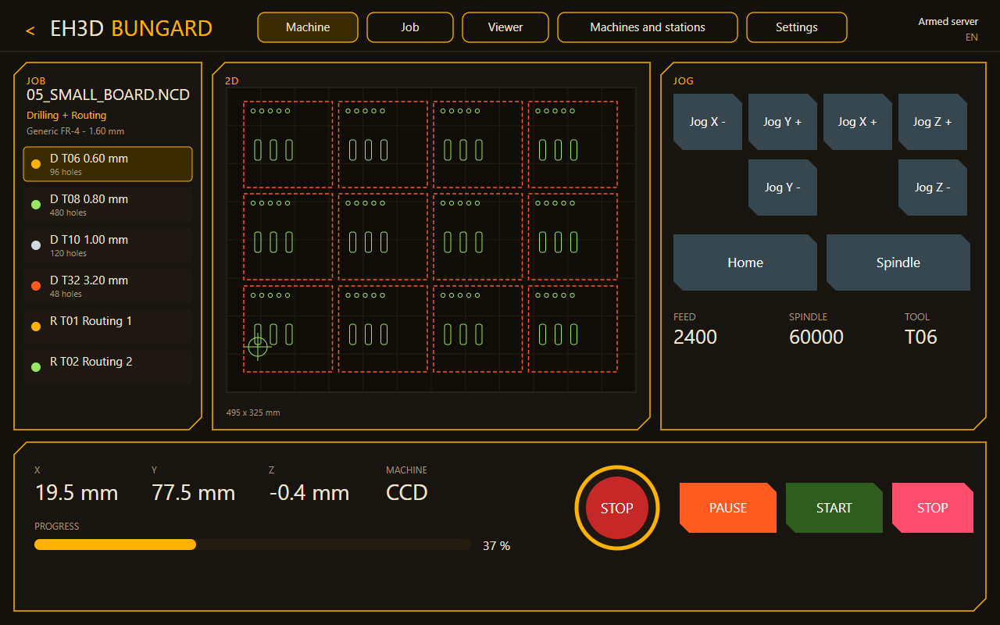
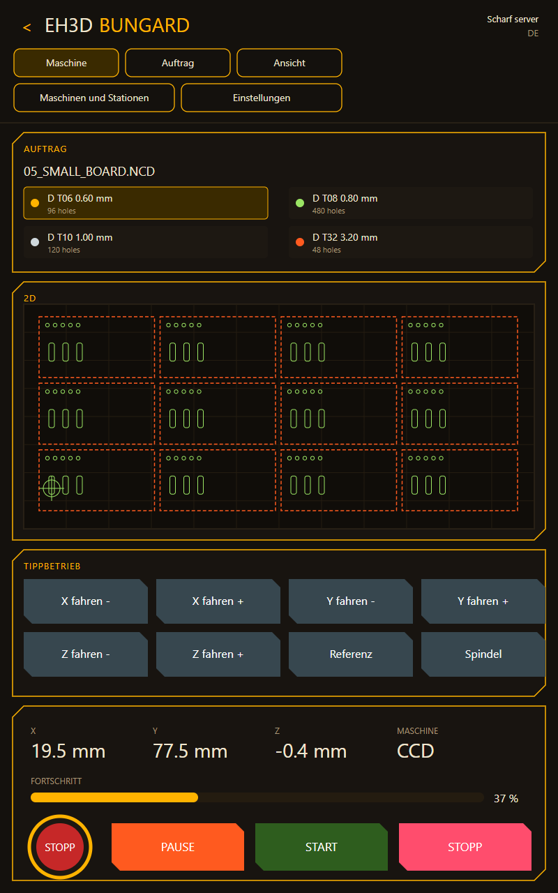
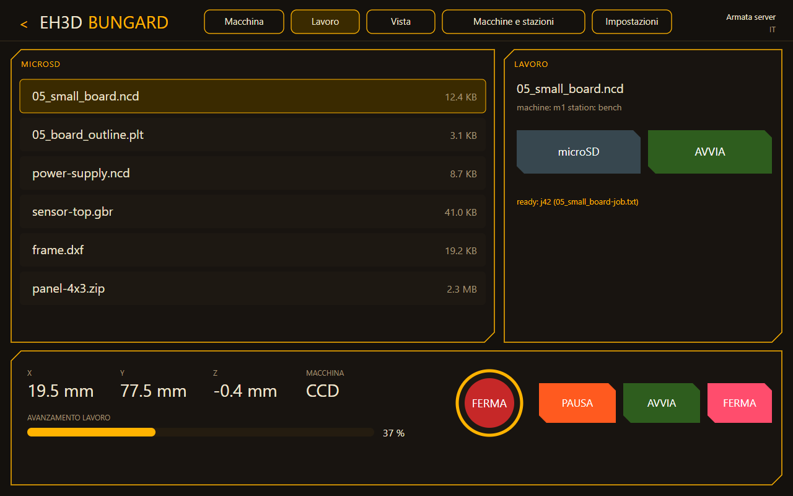
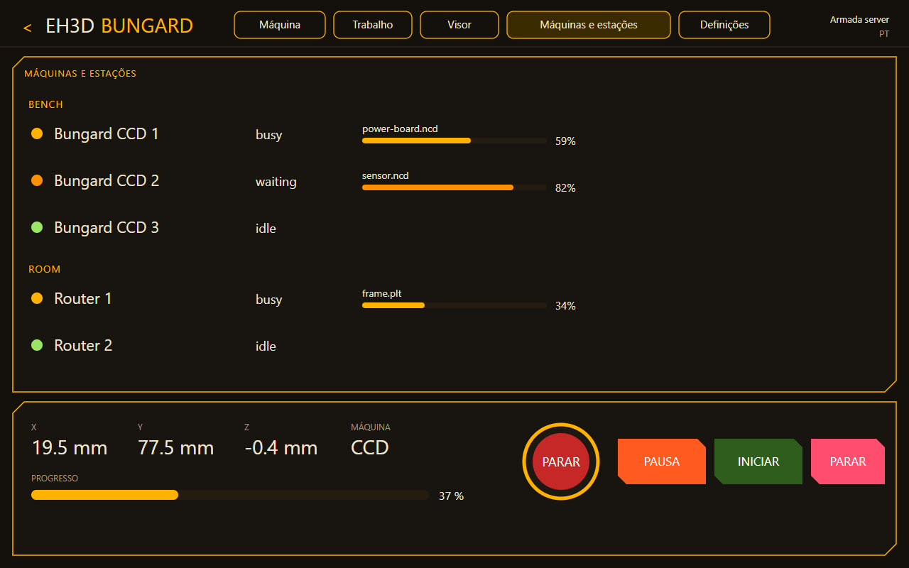
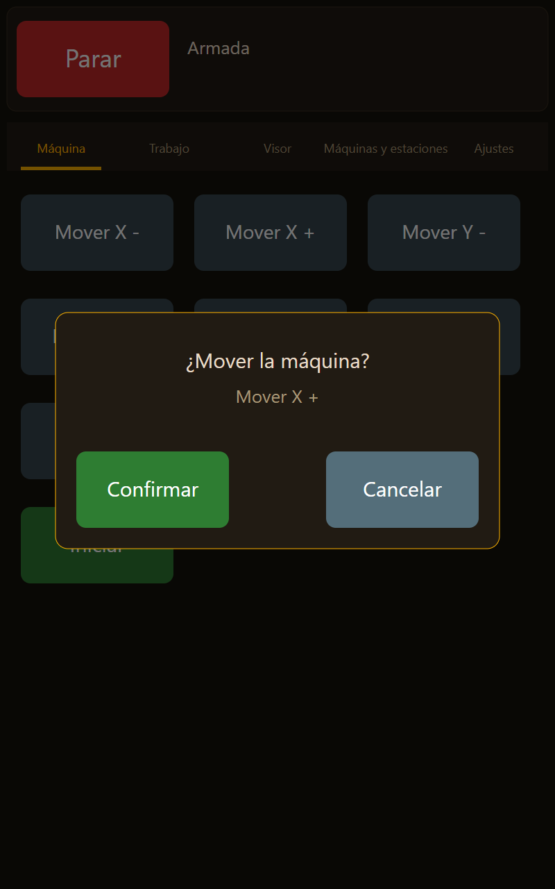
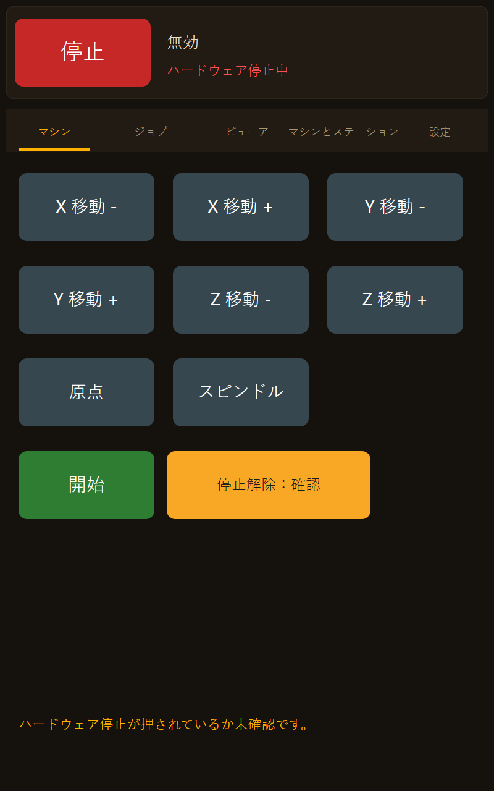

<p align="center">
  
</p>

# 🖥️ EH3D-NODE-BUNGARD-HMI

<p align="center"><a href="README.md">🇺🇸 English</a> | <a href="README_spa.md">🇪🇸 Español</a> | <a href="README_fra.md">🇫🇷 Français</a> | <a href="README_ita.md">🇮🇹 Italiano</a> | <a href="README_deu.md">🇩🇪 Deutsch</a> | <a href="README_zho.md">🇨🇳 中文</a> | <a href="README_jpn.md">🇯🇵 日本語</a> | 🇵🇹 <b>Português</b></p>

### Um ecrã tátil de 10,1 polegadas com um ESP32-P4 que controla sozinho uma máquina Bungard CCD: os ecrãs e o fluxo do programa de secretária, em oito idiomas, avisos e ordens por voz, e uma paragem por hardware que não passa pelo ecrã.

<p align="center">
  
  
  
  
  
</p>

---

**Verificação de honestidade - o que corre hoje:** as regras do ecrã estão escritas em C++17 e testadas num computador: o ficheiro de definições com os valores seguros por omissão, a comporta que cada movimento e cada ordem do fuso tem de passar (uma confirmação no ecrã, o trinco da paragem por hardware, a ligação armada), as ordens e avisos por voz em oito idiomas, os textos dos ecrãs, os esquemas na vertical e na horizontal, os ficheiros do microSD e o cliente do EH3D-SERVER (os pedidos, a leitura da frota e o fluxo de um trabalho desde um ficheiro do cartão até ao fim). O firmware ESP-IDF com os ecrãs LVGL está escrito para o módulo Guition JC8012P4A1C mas **não foi compilado, gravado nem executado num módulo**; nunca falou com um servidor real, e os movimentos da própria máquina (movimento manual, origem) esperam pela ligação ao nó, que ainda não está escrita.

---

> **Estado de segurança (safety) e de segurança informática:** isto não é um sistema de segurança (safety). A paragem que protege as pessoas e a máquina é um botão por hardware que corta o acionamento por si, ligado à parte deste ecrã; o ecrã só o lê, mostra-o e recusa-se a mover o que quer que seja enquanto estiver premido ou por reconhecer. Um movimento ou uma ordem do fuso pede uma confirmação no ecrã, uma ordem por voz pede-a sempre, e as ordens por voz estão desligadas até o operador as ligar. Não uses este ecrã para operar uma máquina até toda a cadeia ter sido testada numa real. O projeto é independente: não é feito, aprovado nem apoiado pela Bungard Elektronik ou pela Guition, e os nomes de produtos aparecem apenas para dizer com que máquinas e módulos se destina a funcionar.

## 📋 Num relance

| | |
|---|---|
| Versão | `0.0.7` |
| Maturidade | Estrutura inicial |
| Testes | 6 programas de teste no computador (88491 verificações contadas) |
| Tecnologias | C++17, ESP-IDF 5.5, LVGL 9, ESP32-P4 |
| Em hardware real | Não: o firmware não foi compilado nem gravado e nada foi ligado a uma máquina |

**Ir para:** [Visão geral](#-visão-geral) · [Arquitetura](#-arquitetura) · [Início rápido](#-início-rápido) · [Testes](#-testes) · [Estrutura](#-estrutura-do-repositório) · [Relacionados](#-projetos-relacionados)

## 🚦 Estado do projeto

Cada linha é uma parte deste repositório e a luz diz até onde chega hoje. É escrita com o que o repositório consegue demonstrar (testes, compilações, execuções), não com o que está previsto.

🟢 Feito e verificado · 🟡 Funciona, com limites conhecidos · 🟠 Feito a meio ou ainda por verificar · 🔴 Por fazer ou a não funcionar

| Área | Estado | O que significa aqui |
|---|---|---|
| Software | 🟠 | O projeto ESP-IDF (ESP32-P4, LVGL 9, o ficheiro de definições na sua própria partição) está escrito; não foi compilado nem gravado. |
| Testes | 🟢 | Passam 6 programas de teste no computador (`ctest`): 88491 verificações do ficheiro de definições, da comporta, das ordens e avisos por voz, dos teclados, dos avisos gravados, do cliente do servidor e dos textos dos ecrãs em oito idiomas. |
| Regras de segurança | 🟡 | Todo o movimento e toda a ordem do fuso passam pela comporta: confirmação no ecrã, trinco da paragem por hardware que só um reconhecimento no ecrã levanta com o botão solto, nenhum movimento com a ligação por armar. Coberto por testes; nunca experimentado com um botão de paragem real. |
| Voz | 🟡 | As ordens e avisos por voz são reconhecidos e formulados em oito idiomas e testados como texto; não se usou nenhum microfone nem altifalante. |
| Ecrãs | 🟠 | Os ecrãs máquina, trabalho (microSD), máquinas e estações e definições estão escritos, na horizontal e na vertical, com o aspeto do programa de secretária; o separador visor ainda é um cartão vazio. Só existe um desenho do esquema, não uma captura de um módulo. |
| Hardware real | 🔴 | Nenhum módulo executou este firmware, a ligação ao servidor ainda não existe e nada foi ligado a uma máquina. |
| Documentação | 🟢 | README em oito idiomas, a referência das definições e as notas de hardware. |
| Servidor e cartão | 🟡 | Os ficheiros do microSD (listagem, nomes seguros, tipos), os pedidos ao EH3D-SERVER, a leitura da frota e o fluxo de um trabalho (enviá-lo pronto, iniciá-lo pela comporta, segui-lo, responder à mudança de ferramenta) são testados num computador com respostas do servidor escritas à mão; os sockets e o controlador do cartão nunca correram num módulo. |

## 🎯 Visão geral

* A **comporta**: todo o movimento e toda a ordem do fuso, venha de um toque ou da voz, passa por um único sítio que decide executá-lo, pedir uma confirmação ou recusá-lo com um motivo; uma paragem passa sempre.
* O **ficheiro de definições** `hmi.cfg`: todo o valor afinado (idioma, brilho, o servidor, os interruptores de segurança, a voz) é uma linha de um ficheiro na sua própria partição, nunca um número no código; um valor fora do intervalo é assinalado e fica o valor seguro por omissão.
* A **voz**: avisos falados (trabalho terminado, mudança de ferramenta, erro, ligação perdida, paragem por hardware) e uma lista curta e fixa de ordens por voz em oito idiomas; as ordens que só param entendem-se dentro de uma frase, as que movem ou rodam têm de ser ditas inteiras e pedem sempre uma confirmação.
* Os **ecrãs**: a máquina (movimento manual, origem, fuso, início, paragem), o trabalho, o visor, as máquinas e estações do servidor e as definições, pela ordem e com os nomes do programa de secretária; o botão de paragem está sempre no topo.
* A **placa face à mesa** e o **fim de um trabalho**: ao escolher no cartão um ficheiro de furação ou de rota, o tamanho da sua caixa é comparado com a mesa da máquina (o curso que o servidor indica menos o desvio, ou `table_width_mm` e `table_depth_mm` de `hmi.cfg`); uma placa que não cabe nem deitada nem rodada é avisada na página do trabalho com o seu tamanho e o que excede, e o trabalho continua permitido (o servidor recusa o que cai fora da mesa). Um trabalho cancelado ou falhado é mostrado como tal com o motivo do servidor, nunca é tomado por terminado (não toca o aviso de fim) e é guardado para continuar a partir dos furos já feitos; o que o servidor anota de um trabalho que pede mais do que o fuso dá é mostrado ao criá-lo.
* O **módulo**: o Guition JC8012P4A1C (ESP32-P4 com 32 MB de RAM externa, ecrã tátil MIPI-DSI de 10,1 polegadas e 800x1280, um ESP32-C6 para o Wi-Fi, o codec ES8311 com amplificador de altifalante e a entrada de microfone ES7210). O painel da unidade é o novo.
* **Na vertical ou na horizontal:** a definição `orientation` (`auto`, `landscape`, `portrait`) roda a imagem do painel: na horizontal (1280 x 800) o trabalho, a vista em planta e o pad de movimento ficam em três colunas sobre a barra de posição, na vertical (800 x 1280) empilham-se; o toque cai onde se toca no ecrã em ambos.
* **O microSD e o servidor, como um só fluxo:** o cartão lista os ficheiros de furação e fresagem; o ecrã envia o ficheiro escolhido ao EH3D-SERVER como um trabalho que espera pronto, o operador inicia-o pela comporta, e o progresso, as paragens para mudança de ferramenta e o fim voltam da frota em tempo real, tal como nos programas de secretária e no nó. A resposta do servidor a cada trabalho fica guardada no cartão.
* **As ferramentas do ficheiro e o fuso:** ao escolher um ficheiro, a página do trabalho mostra o que ele contém (as ferramentas, o seu diâmetro e quantos furos ou cortes cada uma tem) e uma ficha por ferramenta: um toque desliga-a ou liga-a, e o trabalho segue para o servidor sem ela (`skip_tools`); com todas desligadas não se envia nada. Mostra também o fuso que a máquina leva (`original` ou `vfd`) com as suas rotações, como o servidor as indica. Escrito e testado num computador (`core/job_tools.hpp`); não visto num módulo.
* **A comporta respeita o fuso:** uma ordem de fuso leva as rotações que pede (`spindle_rpm`, o que o botão do fuso pede) e a comporta nunca a deixa passar o menor valor entre `spindle_max_rpm` e a velocidade máxima do fuso que a máquina leva, como o servidor a diz. Com `spindle_over = clip` (por omissão) uma ordem que pede mais é reduzida a essa velocidade e o ecrã avisa; com `refuse` é recusada com um motivo. A confirmação mostra as rotações que o fuso vai mesmo receber. Escrito e testado num computador; não visto num módulo.
* **Um trabalho parado continua:** quando um trabalho sai da máquina, o ecrã pergunta ao servidor como terminou; um cancelado ou falhado é mostrado como parado, com os furos (cortes) que fez, e um botão envia de novo o mesmo ficheiro com `skip` igual aos já feitos, de modo que só se fura ou fresa o resto. As ferramentas desligadas continuam desligadas e o arranque passa pela comporta como qualquer outro. Escrito e testado num computador; não visto num módulo. Quando o servidor responde a `resume-from` (guarda o pedido de cada trabalho), o ecrã pede-lhe o trabalho novo em vez de reenviar o ficheiro, pelo que um trabalho continua mesmo depois de reiniciar o ecrã e sem ficheiro; o trabalho novo fica apenas pronto, a página indica o trabalho de que continua e o operador inicia-o pela porta. A um servidor antigo (sem essa rota) responde-se como antes, com o ficheiro que o ecrã guarda.
* **Furar e depois fresar:** um ficheiro de furação e um de fresagem escolhidos um a seguir ao outro são dois programas de um só trabalho: quando o servidor diz que a furação terminou, a fresagem é criada e espera que o operador a inicie, depois da troca de ferramenta, e a página do trabalho nomeia o programa seguinte. Escrito e testado num computador; não visto num módulo.

## 🧩 Papel no EH3D

EH3D-NODE-BUNGARD-HMI é o ecrã próprio do operador de uma máquina Bungard CCD: ocupa o lugar do PC junto à máquina e é mais um cliente do EH3D-SERVER, tal como o EH3D-DRILLPRO, o EH3D-ROUTEPRO e o EH3D-BUNGARD-GUI. Um trabalho que o ecrã envia do microSD é planeado pelo servidor e está no mesmo instante nos programas de secretária; um trabalho iniciado num programa de secretária mostra aqui o seu progresso; o servidor executa-o na máquina através do EH3D-NODE-BUNGARD. Os movimentos diretos do ecrã (movimento manual, origem) vão usar o mesmo nó, e essa ligação ainda não está escrita.

## 🏛️ Arquitetura

<p align="center">
  
</p>

Como as partes deste repositório se encaixam: quem fala com ele, o que contém e de que depende. O desenho sai de `docs/architecture.json` e é verificado contra o código.

## 🖼️ Capturas de ecrã

<p align="center">
  
</p>

<p align="center"><em>O ecrã da máquina na horizontal, em inglês: o trabalho, a vista em planta e o pad de movimento em três colunas, a posição e o botão de paragem na barra. Um desenho do esquema feito com os textos do firmware, não uma captura de um módulo.</em></p>

<p align="center">
  
</p>

<p align="center"><em>O mesmo ecrã na vertical, em alemão: os cartões empilham-se e a barra de posição fica em baixo.</em></p>

<p align="center">
  
</p>

<p align="center"><em>A página do trabalho (aqui em italiano): os ficheiros de furação e fresagem do microSD, o escolhido e o botão que o envia ao servidor como um trabalho que espera pronto.</em></p>

<p align="center">
  
</p>

<p align="center"><em>Máquinas e estações (aqui em português): todas as máquinas do servidor por estação, com o seu estado e o progresso do trabalho, como os veem os programas de secretária.</em></p>

<p align="center">
  
</p>

<p align="center"><em>Um movimento pede uma confirmação antes de acontecer o que quer que seja (aqui em espanhol).</em></p>

<p align="center">
  
</p>

<p align="center"><em>A paragem por hardware está premida: o ecrã di-lo, esbate os botões que movem e recusa-se a mover o que quer que seja até a libertação ser reconhecida (aqui em japonês).</em></p>

## ✨ Funcionalidades

* **Uma paragem que não se esquece:** o botão de paragem está sempre no topo e funciona sempre; a paragem por hardware fica trancada e só um reconhecimento no ecrã, com o botão solto, a levanta.
* **Pausa, retomar e troca de ferramenta:** o botão de pausa retém o trabalho no servidor (nunca o cancela) e um botão deixa-o continuar; numa troca de ferramenta, um botão responde depois de a ferramenta ser trocada. O servidor só retém trabalhos de G-code, por isso, para um trabalho de furação ou de fresagem, responde com o seu motivo, que o ecrã mostra. A paragem é enviada por uma tarefa própria, para o trabalho que o servidor mostra na máquina (também um lançado a partir do computador), com três tentativas e uma espera curta, e premir a paragem por hardware também a envia; se não puder ser enviada, o ecrã di-lo. Escrito e testado num computador; o firmware nunca correu num módulo.
* **Confirmação antes do movimento:** um movimento ou uma ordem do fuso mostra o que vai fazer e espera um toque, com tempo limite; um novo pedido ou uma ligação perdida descarta-o.
* **Oito idiomas, também por voz:** inglês, espanhol, italiano, alemão, francês, português de Portugal, chinês e japonês nos ecrãs, nos avisos falados e nas ordens por voz. Os textos dos ecrãs estão também escritos nas outras 29 línguas da família (búlgaro, croata, checo, dinamarquês, neerlandês, estónio, finlandês, grego, húngaro, irlandês, letão, lituano, maltês, polaco, romeno, eslovaco, esloveno, sueco, norueguês, islandês, ucraniano, russo, sérvio, albanês, catalão, galego, basco, português do Brasil e francês do Canadá), um ficheiro cada uma em `locales/`, com os tipos de letra do ecrã feitos para elas; a língua escolhe-se numa lista com deslocação nas definições. Os avisos e as ordens por voz continuam nas primeiras oito (as outras dizem-se em inglês). Um texto que falte numa língua aparece em inglês. Estes tipos de letra e textos só foram testados no computador, não no ecrã real.
* **Seguro por omissão:** cada interruptor de segurança tem a sua definição e começa na posição prudente: ordens por voz desligadas, confirmação por voz desligada, confirmação ligada, paragem por hardware exigida.
* **O teclado certo para cada definição:** um número escreve-se num teclado numérico que conhece o intervalo e as casas decimais dessa definição (as setas movem-no uma unidade, um valor fora do intervalo não é aceite); um texto, como o endereço do servidor ou o token, num teclado completo com as teclas do idioma em uso (tremas, acentos, til, cedilha), com uma maiúscula de uma letra e uma camada de símbolos; os interruptores e as listas não precisam de teclado.
* **Botões com símbolo:** o pad de movimento, a origem, o fuso, pausa, início, paragem e as respostas a uma pergunta usam símbolos e a letra do eixo em vez de palavras, com as cores do programa de secretária (verde para iniciar, azul para pausar, vermelho para parar).
* **Avisos gravados:** o fim de um trabalho e o pedido de ferramenta podem ser ditos por uma voz gravada, no idioma e no género definidos (`sound_finish = voice:es:f`), a partir da pasta `voices` do cartão; as gravações são as do EH3D-BUNGARD-GUI. O altifalante ainda não está ligado no firmware.
* **O trabalho volta a ser seguido após um reinício:** desde que o operador inicia um trabalho, o ecrã guarda na sua flash qual é (o seu id, a máquina, o seu nome); após um corte de energia ou um reinício segue o mesmo trabalho, a leitura seguinte do servidor diz se ainda corre, espera numa troca de ferramenta ou já terminou, e o botão cancelar deixa-o. O trabalho vive no servidor. Escrito e testado num computador; o firmware nunca correu num módulo.
* **Verificação de qualidade e anel de LEDs:** uma página Verificação de qualidade mostra o veredicto da verificação do trabalho com a câmara da cabeça de furação (APROVADO, REPROVADO ou não avaliável, grande como um cartaz) com o que se encontrou, liga e desliga o anel de LEDs, escolhe a luz para a foto e o furo ao centro, o perfil (padrão, passo fino, protótipo), calibra a escala e lança a verificação; o servidor julga a foto e guarda o perfil, e assim o programa de secretária e os telemóveis mostram a mesma última verificação. O ecrã diz o resultado em voz alta quando `sound_check_ok` e `sound_check_bad` estão definidos (um apito ou uma voz gravada que diz que a verificação visual da placa está correta ou não está correta), e agora também diz o fim de um trabalho e o pedido de uma ferramenta.

## 🔒 Segurança e proteção

| Ameaça | Defesa |
|---|---|
| Um toque ou uma ordem por voz que move a máquina por acidente | um movimento pede uma confirmação no ecrã com tempo limite; uma ordem por voz pede-a sempre; um sim falado só confirma com a definição `voice_confirm` ligada (desligada por omissão) |
| O ecrã começa a mover com a paragem por hardware premida | a paragem por hardware é um trinco: premida, ou solta mas por reconhecer no ecrã, recusa-se todo o movimento e toda a ordem do fuso e descarta-se o que esperava; uma paragem premida enquanto uma confirmação espera cancela-a |
| Uma máquina que não está pronta | nada se move com a ligação por armar, com a entrada de paragem por hardware por ligar (`hw_stop_required`, ligada por omissão) ou com o limite do fuso a 0 |
| Uma palavra falada tomada por uma ordem | as ordens vêm de uma lista curta e fixa por idioma, nunca de texto livre; uma palavra que só contém uma ordem (`stopwatch`) não é uma ordem; as ordens por voz estão desligadas até o operador as ligar |
| Um erro de escrita nas definições | um valor fora do intervalo ou uma chave desconhecida é assinalado e fica o valor seguro por omissão; nenhum interruptor se abre por engano |
| Um segredo no firmware ou no repositório | nada de secreto é compilado; o token é uma definição na sua partição e nunca é mostrado nem registado |

**O que não está defendido:** o ecrã não é um dispositivo de segurança e não pode cortar o acionamento da máquina; isso tem de o fazer a paragem por hardware por si. Ainda não há ligação ao servidor, por isso hoje o ecrã não pode mover nenhuma máquina. O reconhecimento de voz é testado como texto; o caminho real do microfone (cancelamento de eco, ruído, sotaques) não foi experimentado. Quem tiver o módulo nas mãos pode alterar o ficheiro de definições.

## 🔌 Interfaces

| Interface | O que é | Onde |
|---|---|---|
| Ficheiro de definições | `hmi.cfg` na partição `config`: linhas `chave = valor`; ver `hmi.cfg.example` e a tabela acima | `core/hmi_config.hpp` |
| Entrada de paragem por hardware | um GPIO (`HMI_HW_STOP_GPIO` no menuconfig, ativo em baixo por omissão, com pull-up para que um fio aberto conte como premido) | `main/board_p4.cpp` |
| Ecrã tátil | MIPI-DSI de 800x1280 através do LVGL 9 | `main/ui.cpp` |
| Som | codec ES8311 com amplificador de altifalante e a entrada de microfone ES7210 | `main/board_p4.cpp` |
| microSD | a raiz do cartão em `/sdcard`: listam-se e leem-se ficheiros de furação, fresagem, Gerber, DXF e ZIP e escrevem-se relatórios; só se aceitam nomes de ficheiro simples | `core/sdfiles.hpp`, `main/board_p4.cpp` |
| EH3D-SERVER | HTTP com o token de acesso: `GET /api/v1/fleet` a cada `poll_s` segundos, `POST /api/v1/machines/:id/jobs`, `POST /api/v1/jobs/:id/start`, `confirm` e `cancel` | `core/server_link.hpp`, `main/server_link.cpp` |

## ⚙️ Configuração

Tudo o que é afinado é uma linha de `hmi.cfg` (copia `hmi.cfg.example` para a partição `config`); um valor fora do intervalo é assinalado no registo e fica o valor por omissão. Os valores abaixo são os de omissão; todos os de segurança são os prudentes.

| Definição | Omissão | Intervalo | O que faz |
|---|---|---|---|
| `language` | `en` | `en es it de fr pt zh ja` | o idioma dos ecrãs e da voz |
| `confirm_moves` | on | on / off | pede confirmação para mover: desligar só na bancada |
| `confirm_timeout_ms` | 8000 | 1000 - 60000 | quanto tempo espera uma confirmação |
| `jog_max_mm` | 20 | 1 - 200 | o movimento manual mais longo que o ecrã envia |
| `spindle_max_rpm` | 24000 | 0 - 65535 | a velocidade máxima do fuso que pede (0: nunca arranca o fuso) |
| `spindle_rpm` | 12000 | 0 - 65535 | as rotações que o botão do fuso pede (0: a velocidade do trabalho); a comporta reduz-as ao que o fuso dá |
| `spindle_over` | clip | clip / refuse | uma ordem com mais rotações do que o fuso dá: reduzida à sua velocidade máxima com aviso, ou recusada |
| `hw_stop_required` | on | on / off | só comanda a máquina com a entrada de paragem por hardware ligada e solta |
| `voice_orders` | off | on / off | aceita ordens por voz |
| `voice_confirm` | off | on / off | aceita um sim falado como confirmação de um movimento |
| `token` | none | 8 - 64 characters | o token de acesso ao servidor; só de escrita, nunca mostrado nem registado |
| `orientation` | `auto` | `auto landscape portrait` | vertical ou horizontal; `auto` segue a montagem do módulo |
| `poll_s` | 3 | 1 - 60 | de quanto em quanto tempo o ecrã pede a frota ao servidor |
| `table_width_mm` | 0 | 0 - 5000 | a largura da mesa da máquina para o aviso de uma placa que não cabe; 0 = a que o servidor indica (o curso menos o desvio) |
| `table_depth_mm` | 0 | 0 - 5000 | a profundidade da mesa; 0 = a que o servidor indica |

## 🚀 Início rápido

Precisas de um compilador C++17 e do CMake para os testes no computador, e do ESP-IDF 5.5.5 para o firmware (o alvo ESP32-P4 do módulo).

```bash
build.bat            # the host tests (Windows)  -  ./build.sh on Linux
python -I tools/ci_validate.py
```

O firmware ainda não foi compilado: quando for, `idf.py set-target esp32p4 && idf.py build` gera a imagem e uma partição chamada `config` guarda `hmi.cfg`.

## 🧪 Testes

Os testes no computador (`build.bat` ou `./build.sh`, e depois `ctest`) são dois programas e passa tudo: `test_hmi` (1008 verificações) do ficheiro de definições, da comporta (a paragem passa sempre, trinco da paragem por hardware, confirmação, tempo limite e volta do relógio, regras de voz, interruptores), das ordens e avisos por voz e dos textos de ecrã em oito idiomas; e `test_workflow` (315 verificações) da orientação e do toque, dos ficheiros do cartão (tipos, nomes seguros, ordenação), do leitor de JSON, dos pedidos e respostas do servidor e do fluxo de um trabalho desde o cartão até ao fim. Os outros dois programas cobrem os teclados (`test_keyboard`, 231 verificações: cada definição tem o seu teclado, os intervalos do teclado numérico são os do ficheiro de definições, as casas decimais, o sinal, as setas, o teclado completo de cada idioma, a maiúscula, os símbolos e o comprimento) e os avisos gravados (`test_notices`, 266 verificações: a definição, o ficheiro de cada idioma e género). Os dois últimos programas são `test_quality` (911 verificações: os pedidos, a leitura do relatório, cada achado) e `test_locales` (85760 verificações: cada chave tem texto em cada uma das outras 29 línguas, nada está vazio nem é demasiado longo, a escrita de cada língua é a certa, o que deve ficar fica, e cada carácter que um texto possa desenhar está no intervalo dos tipos de letra gerados).

Autoteste para o dia em que o ecrã encontra o hardware: `python tools/selftest.py` verifica `hmi.cfg.example` (ou `--cfg FICHEIRO`) com as regras do firmware e arranca um servidor de brincar na porta 18200 para confirmar que as suas respostas são as que o ecrã espera; com `--server HOST:PORTA` faz as mesmas perguntas a um servidor real usando só GET. Não envia nada ao hardware. Os seus testes correm na CI (`python -I -m unittest discover -s tools -p "test_*.py"`). Os passos manuais no ecrã estão em [docs/HARDWARE_CHECKLIST.md](docs/HARDWARE_CHECKLIST.md).

## 🏗️ Compilação e publicação

A versão vive em `eh3d.project.json` e cada versão tem a sua entrada em [CHANGELOG.md](CHANGELOG.md). `build.sh` / `build.bat` compilam e executam os testes no computador e `test.sh` / `test.bat` executam as verificações do repositório. O firmware compila-se fora dos scripts deste repositório, numa janela visível, uma compilação de cada vez.

## 🩺 Resolução de problemas

| Sintoma | O que fazer |
|---|---|
| Nada se move e o ecrã diz que a paragem por hardware está premida ou por reconhecer | Solta o botão e prime o botão de reconhecer do ecrã: uma paragem que foi solta não se levanta sozinha. |
| O ecrã diz que a máquina não está armada | Nesta versão ainda não há ligação à máquina; a comporta recusa todo o movimento até uma ligação a armar. |
| O ecrã diz que a entrada de paragem por hardware não está ligada | Liga o botão de paragem ao pino definido no menuconfig (`HMI_HW_STOP_GPIO`), ou desliga `hw_stop_required` apenas na bancada. |
| Uma ordem por voz não faz nada | As ordens por voz estão desligadas por omissão: põe `voice_orders = on`. As que movem ou rodam pedem um toque no ecrã, salvo se `voice_confirm` estiver ligado. |

## 📂 Estrutura do repositório

<p align="center">
  
</p>

<details>
<summary>Versão em texto da árvore</summary>

```text
EH3D-NODE-BUNGARD-HMI/
├── core/
│   ├── hmi_config.hpp lang.hpp                       o ficheiro de definições e os seus valores seguros
│   ├── gate.hpp                                      a comporta: confirmação, trinco da paragem
│   ├── voice.hpp                                     ordens e avisos por voz em oito idiomas
│   ├── orientation.hpp sdfiles.hpp                   vertical e horizontal, ficheiros do cartão
│   ├── server_link.hpp workflow.hpp job_memory.hpp   cliente do servidor e fluxo de um trabalho
│   ├── job_tools.hpp                                 as ferramentas de um ficheiro e as desligadas
│   ├── quality.hpp                                   a verificação de qualidade e o anel de LEDs
│   ├── ui_text.hpp keyboard.hpp notices.hpp          textos, teclados e avisos
│   ├── locales.hpp locales_gen.hpp font_ranges.hpp   37 idiomas e intervalos de letra
│   └── wav.hpp                                       as gravações e os apitos dos avisos
├── main/
│   ├── app_main.cpp                                  arranque, definições, o ciclo da comporta
│   ├── ui.cpp ui.hpp                                 os ecrãs LVGL e o botão de paragem
│   ├── fonts/                                        os tipos: do latim ao japonês
│   ├── board_p4.cpp board.hpp                        o módulo: ecrã, som, entrada de paragem
│   ├── server_link.cpp server_link.hpp               os sockets do cliente do servidor
│   └── idf_component.yml Kconfig.projbuild           lista de componentes e pinos do menuconfig
├── tests/                                            testes no computador das definições, da comporta, da voz e dos textos de ecrã
├── locales/                                          os textos das outras 29 línguas, um ficheiro cada
├── docs/                                             as notas de hardware e as fontes dos dois desenhos
├── tools/                                            verificação de CI, de README e ferramentas dos desenhos
├── CMakeLists.txt                                    o projeto ESP-IDF
├── partitions.csv                                    a divisão da flash com duas ranhuras
├── hmi.cfg.example                                   cada definição com o seu valor por omissão e intervalo
├── sdkconfig.defaults                                definições do ESP-IDF para o módulo ESP32-P4
├── sdkconfig.board.p4                                definições da placa
├── dependencies.lock                                 as versões exatas dos componentes
├── images/                                           banner e as imagens de Arquitetura e Estrutura do repositório
├── .github/                                          fluxos de CI e de publicação, modelos de issues e pull requests
├── build.sh build.bat                                compila e executa os testes no computador num painel em direto
├── eh3d.project.json                                 manifesto: versão, papel, maturidade e comando de compilação
├── CHANGELOG.md                                      o que mudou em cada versão
├── SECURITY.md SUPPORT.md                            como comunicar uma vulnerabilidade e onde perguntar
├── CONTRIBUTING.md CODE_OF_CONDUCT.md LICENSE        como contribuir, o código de conduta e a licença
└── bump_manifest_version.py                          utilitário de versão do manifesto
```

</details>

## 🗺️ Roteiro e limites conhecidos

**Limites conhecidos hoje**

* Nada correu num módulo: o firmware não foi compilado, gravado nem experimentado, e o pacote de suporte de placa que pede pode precisar de alterações para este módulo.
* O ecrã só chega à máquina através de um trabalho do EH3D-SERVER; os seus próprios movimentos (movimento manual, origem, fuso) consultam a comporta e depois esperam pela ligação ao nó, que ainda não está escrita. O cliente do servidor e o cartão nunca correram num módulo.
* O pino da paragem por hardware e o controlador tátil ainda não estão fixados: têm de ser verificados com o esquema da unidade.
* O reconhecedor de voz e o altifalante ainda não estão no firmware; as ordens e avisos são testados como texto.
* A lógica dos programas de secretária (formatos, controlador, frota) não é reutilizada: os ecrãs seguem o programa de secretária, mas as regras são reescritas em C++.

**A seguir**

* Compilar o firmware e arrancar o módulo: ecrã, tátil e som.
* Escrever a ligação ao EH3D-SERVER e ao nó, e preencher os outros separadores dos ecrãs.
* Juntar o reconhecedor de voz e o altifalante e experimentá-los com cancelamento de eco.
* Ligar um botão de paragem real e experimentar o trinco numa máquina.

## 🌍 Idiomas

O README e os textos existem em inglês, espanhol, francês, italiano, alemão, chinês, japonês e português europeu.

## 🔗 Projetos relacionados

* [EH3D-DRILLPRO](https://github.com/JuanenRac/EH3D-DRILLPRO): o programa de secretária que os ecrãs seguem
* [EH3D-ROUTEPRO](https://github.com/JuanenRac/EH3D-ROUTEPRO): o programa de fresagem; partilha o ficheiro de máquina e a biblioteca do protocolo
* [EH3D-SERVER](https://github.com/JuanenRac/EH3D-SERVER): o centro da família: executa os trabalhos de cada cliente
* [EH3D-NODE-BUNGARD](https://github.com/JuanenRac/EH3D-NODE-BUNGARD): o nó da porta série da unidade de controlo da máquina
* [EH3D-COMMON](https://github.com/JuanenRac/EH3D-COMMON): as partes comuns da família (formatos, controlador, frota, temas)

## 📚 Documentação

* As definições: `hmi.cfg.example` lista cada chave com o seu valor por omissão e o intervalo.
* O hardware: os pinos do módulo e as notas que acompanham a demo do fabricante, em `docs/HARDWARE.md`.
* [Registo de alterações](CHANGELOG.md)

## 🤝 Contribuir e comunidade

* Antes de um pull request executa os testes no computador (`./build.sh` ou `build.bat`) e `python -I tools/ci_validate.py`: tudo tem de passar. Vê [CONTRIBUTING.md](CONTRIBUTING.md) e o [código de conduta](CODE_OF_CONDUCT.md).
* O README existe em oito idiomas: uma alteração do texto faz-se nos oito ficheiros, e os dois desenhos saem de `docs/architecture.json` e `docs/structure.json` com `tools/make_architecture.py` e `tools/make_structure.py`.
* Nada que permita ao ecrã mover uma máquina muda sem um teste da comporta que o cubra e uma nota do que foi observado em hardware.
* Comunica uma vulnerabilidade em privado: [SECURITY.md](SECURITY.md). Perguntas, ideias e relatórios: electrohobby3d@gmail.com ([SUPPORT.md](SUPPORT.md)).

## 👤 AUTOR

**JuanenRac (Electro Hobby 3D)** · electrohobby3d@gmail.com

## 📜 LICENÇA

Software: GPL-3.0-or-later. Ver [LICENSE](LICENSE). Os projetos de hardware da suite usam a CERN OHL-S.
